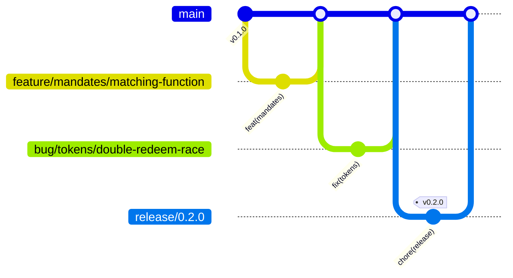

# Contributing to Mandit OS

Thank you for contributing to Mandit OS. This document defines how work is proposed, developed, reviewed, documented and released. It applies to every contributor and every team. Read it in full before opening your first pull request, together with the [System Reference](docs/REFERENCE.md) and the module document for your team in [`docs/modules/`](docs/modules/).

## Table of Contents

1. [Introduction](#1-introduction)
2. [Code of Conduct](#2-code-of-conduct)
3. [Ground Rules](#3-ground-rules)
4. [Getting Started](#4-getting-started)
5. [Branching Model](#5-branching-model)
6. [Branch Naming](#6-branch-naming)
7. [Commit Messages](#7-commit-messages)
8. [Pull Requests](#8-pull-requests)
9. [Contract Changes](#9-contract-changes)
10. [Documentation Obligations](#10-documentation-obligations)
11. [Coding Standards](#11-coding-standards)
12. [Testing Requirements](#12-testing-requirements)
13. [Security-Sensitive Changes](#13-security-sensitive-changes)
14. [Issues and Labels](#14-issues-and-labels)
15. [Definition of Done](#15-definition-of-done)
16. [Release Process](#16-release-process)
17. [Ways of Working](#17-ways-of-working)
18. [Licence](#18-licence)

---

## 1. Introduction

Mandit OS is developed by six teams working in parallel on interdependent modules. The rules below exist for three reasons:

- to keep `main` integrable at all times;
- to make cross-team effects visible before they cause breakage;
- to keep the documentation an accurate description of the system.

## 2. Code of Conduct

All participation is governed by the [Code of Conduct](CODE_OF_CONDUCT.md). Report unacceptable behaviour as described there.

## 3. Ground Rules

1. **Synthetic data only.** Never commit or use real card numbers, bank credentials, UPI identifiers, personal data or real merchant credentials. Use the fixtures in the repository.
2. **No secrets in the repository.** Keys, tokens and passwords belong in environment variables or the secrets manager. Use `.env.example` for placeholders. If a secret is committed, treat it as compromised and follow the [README Security section](README.md#security).
3. **Enforcement outside the model.** No safety property may rely on an agent, a prompt or an LLM behaving correctly.
4. **Respect the safety invariants.** The invariants in [REFERENCE.md §2.2](docs/REFERENCE.md#22-safety-invariants-frozen-at-the-week-2-gate) may only be changed with approval from all team leads.
5. **Respect module boundaries.** Do not read or write another module's tables, and do not import from another module except through its `interface.py`.
6. **Evidence before action.** Every significant state change emits a registered ledger event.
7. **Honesty.** Report test results and metrics truthfully, including failures. Do not describe the prototype as production-ready.

## 4. Getting Started

### 4.1 Prerequisites

| Tool | Version |
|---|---|
| Git | 2.40 or later |
| Python | 3.12 |
| Node.js | 24 LTS (pinned in `.nvmrc`; install with `nvm use`) |
| `pnpm` | 9 or later |
| PostgreSQL | 16 (local install, or Docker for the database only; see §4.2) |
| Docker | Optional until the Compose environment is added (Week 3 or later) |

Python dependencies live in `requirements.txt` (runtime) and `requirements-dev.txt` (test and lint). Add a package to the right file in the same PR that first imports it.

### 4.2 First-time setup

Every contributor runs their **own local database**. Databases are never committed. What is committed is the schema (Alembic migrations) and the synthetic seed script, so anyone can rebuild an identical database in seconds.

```bash
git clone https://github.com/HeapifyGlobalCommunityy/Mandit-OS.git
cd Mandit-OS
python3.12 -m venv .venv && source .venv/bin/activate
pip install -r requirements-dev.txt
cp .env.example .env                    # contains DATABASE_URL and other synthetic, non-secret defaults
# Create the database. Pick ONE:
#   a) local Postgres:   createdb mandit && createdb mandit_test
#   b) Docker (DB only): docker run -d --name mandit-pg -e POSTGRES_PASSWORD=mandit -e POSTGRES_DB=mandit -p 5432:5432 postgres:16   # then: docker exec mandit-pg createdb -U postgres mandit_test
alembic upgrade head                    # creates all tables
python -m scripts.seed                  # loads synthetic users, merchants and agents
```

Rules: the schema changes only through a new Alembic migration (one per change, reversible); tests use the separate `mandit_test` database and never touch your dev data; to reset, drop the database and run the two commands above again. Make targets (`make setup`, `make dev`, `make test`) will wrap these steps once the scaffolding pull request lands.

### 4.2.1 Database and migrations

Docker and `apt` only provide the PostgreSQL **server**, and the database starts empty. Tables come from Alembic, which is a separate command that connects using `DATABASE_URL` from your `.env`. The setup is the same for Docker and native installs.

| When | Command |
|---|---|
| First setup, and after every `git pull` | `alembic upgrade head` (applies only the migrations you haven't run yet) |
| Check where your database is | `alembic current` |
| Undo your last migration (your own unmerged work) | `alembic downgrade -1` |
| Start from a clean slate | `dropdb mandit && createdb mandit && alembic upgrade head && python -m scripts.seed` (with Docker: `docker exec mandit-pg dropdb -U postgres mandit`, and so on) |
| Create a migration after changing a model | `alembic revision -m "short description"`, then write the SQL in `upgrade()`/`downgrade()` (autogenerate only works once SQLAlchemy models exist) |

Restarting or recreating a Docker container without a volume wipes the database; just rerun the two setup commands. Tests apply migrations to `mandit_test` automatically from the pytest fixtures, so you do not run them by hand for tests. If a test run reports a missing table or column, you probably forgot `alembic upgrade head` after pulling.

> `requirements*.txt`, `.env.example`, `alembic.ini` and migrations `0001`–`0005` exist. The seed script (`scripts/seed.py`) is still to be written.

### 4.3 Pre-commit hooks

Install the hooks with `pre-commit install`. They run formatting, linting, a secret scan (`gitleaks`) and the documentation registry checks. Do not bypass them with `--no-verify`.

## 5. Branching Model

The repository uses trunk-based development: `main` is the single integration branch. There is no `develop` branch.

| Branch | Purpose | Who merges into it | Protection |
|---|---|---|---|
| `main` | Integration branch. **All work targets `main`.** It must stay integrable at all times. | Pull requests from working branches | Protected; no direct pushes; CI must pass; reviews per §8.5 |
| Working branches | One unit of work each (§6) | n/a | n/a |
| `release/x.y.z` | Release stabilisation, cut from `main` | Fixes only | Protected |
| `hotfix/x.y.z-<desc>` | Urgent fix to a released version, cut from its `vX.Y.Z` tag | n/a | n/a |



Rules:

1. **Pull requests target `main`.**
2. Create working branches from the latest `main`.
3. Keep your branch current by rebasing onto `main` (`git fetch origin && git rebase origin/main`). Do not merge `main` into your branch.
4. Delete working branches after merge.
5. Fixes made on a `release/` or `hotfix/` branch are also merged into `main`.

## 6. Branch Naming

### 6.1 Format

```
<type>/<module>/<short-description>
```

- `type`: one of the types in §6.2.
- `module`: one of the module scopes in §6.3, or `multi` when the change spans several modules.
- `short-description`: lowercase, kebab-case, 3 to 6 words. An issue number may be used as a prefix (`42-mandate-expiry-check`).

Only lowercase letters, digits, hyphens and the two `/` separators are permitted.

### 6.2 Types

| Type | Use for |
|---|---|
| `feature/` | New functionality |
| `bug/` | Defect fixes on `main` |
| `hotfix/` | Urgent fixes to a released version on `main` |
| `security/` | Fixes for security weaknesses (see §13 and the [README Security section](README.md#security)) |
| `docs/` | Documentation-only changes |
| `test/` | Tests and corpus cases only |
| `refactor/` | Code changes with no behaviour change |
| `perf/` | Performance improvements |
| `chore/` | Tooling, dependencies, build and CI |
| `release/` | Release preparation (`release/1.0.0`) |
| `experiment/` | Short-lived spikes that will not be merged as-is |

### 6.3 Module scopes

`identity`, `mandates`, `sdk`, `gateway`, `safety`, `grounding`, `registry`, `mock-merchant`, `policy`, `confirmation`, `tokens`, `payments`, `mock-psp`, `evidence`, `console`, `demo-agent`, `redteam`, `common`, `schemas`, `infra`, `ci`, `docs`, `multi`.

### 6.4 Examples

| Branch | Meaning |
|---|---|
| `feature/identity/kya-challenge-token` | Team 1 adds challenge-response credential issuance |
| `feature/mandates/42-matching-function` | Team 1 implements mandate matching for issue #42 |
| `feature/safety/hidden-text-detector` | Team 2 adds the hidden-text detector |
| `bug/tokens/double-redeem-race` | Team 4 fixes a concurrency defect |
| `security/gateway/nonce-replay-window` | Team 2 fixes a replay weakness |
| `docs/evidence/event-catalog-v1` | Team 5 publishes the first event catalogue |
| `test/redteam/payee-swap-corpus` | Team 6 adds attack cases |
| `chore/ci/add-gitleaks` | CI change |
| `feature/multi/proposal-hash-v2` | Cross-module contract change |

## 7. Commit Messages

Commits follow [Conventional Commits 1.0.0](https://www.conventionalcommits.org/).

```
<type>(<scope>): <summary in imperative mood, max 72 characters>

<body: what and why, wrapped at 100 characters>

<footer: BREAKING CHANGE:, Refs: #issue, Co-authored-by:>
```

| Commit type | Corresponding branch type |
|---|---|
| `feat` | `feature/` |
| `fix` | `bug/`, `hotfix/`, `security/` |
| `docs` | `docs/` |
| `test` | `test/` |
| `refactor` | `refactor/` |
| `perf` | `perf/` |
| `build`, `ci`, `chore` | `chore/` |
| `revert` | n/a |

The scope is a module scope from §6.3.

Examples:

```
feat(mandates): return all violations from match()

The matcher previously stopped at the first violation, which produced incomplete
explanations. It now collects every violation and every signal.

Refs: #42
```

```
fix(tokens)!: bind redemption to payee_id

BREAKING CHANGE: /v1/payment-tokens/redeem now requires payee_id.
Mock PSP updated in the same PR.
```

Breaking changes are marked with `!` after the scope and a `BREAKING CHANGE:` footer. Pull requests are squash-merged, so the pull request title becomes the final commit message and must follow this format.

## 8. Pull Requests

### 8.1 Target branch

**All pull requests target `main`.** Pull requests into a `release/` branch are limited to fixes and are managed by the technical lead.

### 8.2 Before opening a pull request

- [ ] The branch is rebased onto the latest `main`.
- [ ] `make ci` passes locally.
- [ ] New behaviour has tests (§12).
- [ ] Documentation obligations are met (§10).
- [ ] No secrets, real personal data or real payment data are included.
- [ ] The pull request contains one logical change.

### 8.3 Title and description

- **Title:** Conventional Commits format, for example `feat(policy): add HG-10 agent amount mismatch gate`.
- **Description:** use the [pull request template](.github/PULL_REQUEST_TEMPLATE.md) in full. Do not delete sections. Write "N/A" where a section does not apply.
- Link the issue with `Closes #NN` or `Refs #NN`.

### 8.4 Affected modules declaration (mandatory)

Every pull request must state whether **any module other than the one being changed** is affected, or may need changes, as a result. This is a required section of the template.

- If other modules are affected, list each one with: the module, the owning team, the nature of the impact (for example "consumes the changed response field" or "must emit the new event"), and whether a follow-up change is needed (with an issue link) or is included in this pull request.
- If no other module is affected, write **"No"** explicitly. An empty or missing declaration blocks review.

Example:

```markdown
## Affected Modules

| Module | Team | Impact | Action |
|---|---|---|---|
| policy | Team 4 | `MatchResult.signals` is now a list of objects instead of strings | Follow-up: #57 |
| evidence | Team 5 | New event `SPEND_RELEASED` | Catalogue entry included in this PR |
```

or:

```markdown
## Affected Modules

No
```

When other modules are affected, add the label `cross-team` and request a review from each affected team (§8.5).

### 8.5 Review requirements

| Change type | Minimum approvals |
|---|---|
| Documentation only (`docs/`) | 1 |
| Code within one module, no contract change | 1, from the owning team |
| Changes affecting other modules (`cross-team`) | 1 from the owning team **plus** 1 from each affected team |
| Contract changes (§9) | 2, from at least two different teams, including every consuming team |
| Security-sensitive paths (§13): `identity`, `mandates`, `policy`, `tokens`, `payments`, `evidence`, `common/crypto`, `common/jcs` | 2, at least one from outside the authoring team |
| Changes to safety invariants or policy weights and thresholds | All team leads |

Reviewer responsibilities:

1. Check correctness, tests, and adherence to this guide.
2. Verify the affected-modules declaration is accurate. Reviewers should look for unlisted impacts.
3. Verify the documentation obligations (§10) are met.
4. Use GitHub suggestions for small fixes. Distinguish blocking comments from optional ones (prefix optional comments with `nit:`).
5. Respond within one working day.

Authors resolve a conversation only after addressing it. Reviewers re-approve after significant changes.

### 8.6 Continuous integration

A pull request can be merged only when all required checks pass. Checks run in GitHub Actions
(`.github/workflows/ci.yml`) on every pull request into `main` and every push to `main`. Each check
calls a `make` target, so the same command reproduces it locally.

| Check | Description | Status | Run locally |
|---|---|---|---|
| `lint` | Ruff (lint and format), mypy (strict for `common/`, `policy/`, `tokens/`); ESLint, Prettier, `tsc --noEmit` once the console exists | **Active** (Python only) | `make lint` |
| `test-unit` | pytest (every module must import; per-module tests under `services/core/tests/`); Vitest once the console exists | **Active** (pytest only) | `make test` |
| `test-integration` | Compose-based integration suite | Planned (needs Compose) | n/a |
| `redteam-scripted` | Scripted attack corpus; any HIGH-severity regression fails | Planned (needs corpus) | n/a |
| `contracts` | Schema validation; `interface.py` import-linter rules; generated types up to date | Planned | n/a |
| `docs-registry` | Every emitted event and code is registered; every code has an explanation template; links resolve | Planned | n/a |
| `secrets` | gitleaks over the full git history | **Active** | `make secrets` (Docker) |
| `migrations` | Alembic migrations apply to an empty Postgres 16, roll back to base leaving nothing behind, and re-apply to an identical schema | **Active** | `make migrations` (empty DB at `DATABASE_URL`) |

Run `make ci` (lint and unit tests) before opening a pull request. Repository administrators mark
the active checks as required in the branch protection rule for `main`.

### 8.7 Merging

- Squash and merge. The squashed message is the pull request title plus a summary.
- The author merges after the required approvals, unless the author lacks permission.
- Do not merge a pull request with unresolved blocking comments or failing checks.
- Breaking changes merge only after the dependent pull requests in other modules are approved, or are merged together in a coordinated sequence agreed in the issue.

### 8.8 Size and drafts

- Aim for pull requests under roughly 400 changed lines, excluding generated files and fixtures. Split larger work into stacked pull requests.
- Open a **draft** pull request early to get feedback on direction. Mark it ready only when the checklist is complete.

## 9. Contract Changes

A **contract** is anything another module or team depends on:

- HTTP endpoints (path, method, auth, request and response bodies, status codes);
- MCP tools;
- JSON Schemas in `schemas/`;
- service interfaces in `interface.py`;
- ledger event types and payloads;
- error and reason codes;
- policy rule IDs, the Trust Score definition, weights and thresholds;
- database tables shared through snapshots.

Process:

1. Open an issue labelled `contract-change` that describes the change and lists the consumers.
2. For breaking changes, record the rationale in the PR description.
3. Implement the change, keeping backward compatibility where feasible (new optional fields; a new version alongside the old one).
4. Update every affected document in the same pull request (§10).
5. Obtain approvals from every consuming team (§8.5).
6. Announce the merge in the team channel, with a link to the PR.

Versioning rules:

| Artefact | Rule |
|---|---|
| HTTP API | Additive changes within `/v1`; breaking changes require `/v2` routes and a deprecation period |
| JSON Schemas | `name.vN.json`; a breaking change creates `vN+1` and keeps `vN` |
| Event payloads | `schema_version` per event; old versions remain readable for replay |
| Policy | `policy-x.y.z` (SemVer); every released version remains importable for replay |
| Trust model | `trust-x.y.z`; changes require team-lead approval and a before-and-after evaluation |

## 10. Documentation Obligations

Documentation is part of the definition of done. Update docs **in the same pull request** as the change ("docs to follow" is not accepted). Do not document planned behaviour as implemented; label it **Planned** or **Phase 2**. Reviewers block PRs that change the left column without the right.

| If your change… | You must update… |
|---|---|
| Adds or changes an HTTP endpoint (path, method, auth, shapes, status codes) | The owning module document **and** [REFERENCE.md §9](docs/REFERENCE.md#9-endpoint-catalogue) |
| Adds or changes an MCP tool | [REFERENCE.md §10](docs/REFERENCE.md#10-mcp-tool-surface) and [02-safety-scanning.md](docs/modules/02-safety-scanning.md) |
| Adds or changes a shared entity or schema | `schemas/*.json`, [REFERENCE.md §13](docs/REFERENCE.md#13-core-data-entities), the owning module document |
| Adds or changes a service interface (`interface.py`) | The owning module document, §3 |
| Emits a new ledger event or changes a payload | The event catalogue ([05 §12](docs/modules/05-evidence-and-experience.md#12-ledger-event-catalogue)) and `schemas/events/`; request Team 5 review |
| Emits a new error or reason code | [REFERENCE.md Appendix B](docs/REFERENCE.md#appendix-b-error-and-reason-codes) and an explanation template (Team 5) |
| Adds or changes a policy rule, weight or threshold | [REFERENCE.md §11](docs/REFERENCE.md#11-decision-model), [04-policy-and-payments.md](docs/modules/04-policy-and-payments.md), and a version bump |
| Adds or changes a database table owned by a module | The owning module document, §4 |
| Addresses or discovers a threat | [REFERENCE.md Appendix C](docs/REFERENCE.md#appendix-c-threat-model) and a corpus case in `redteam/corpus/` |
| Passes a gate, or starts, completes or re-scopes a Phase 2 item | [REFERENCE.md §15](docs/REFERENCE.md#15-delivery-plan-and-integration-gates) and the module's improvement table |
| Produces new evaluation results | [06 §12](docs/modules/06-red-team-and-evaluation.md#12-evaluation-results-log) (append only) |
| Introduces a new term | [REFERENCE.md Appendix A](docs/REFERENCE.md#appendix-a-glossary) |
| Resolves an open question or relies on a new assumption | State it in the PR description; update the README open questions if it was listed there |
| Changes a module's internal design | The module design note (`services/core/mandit/<module>/README.md`) |

Significant or irreversible design decisions are recorded in the PR description and the relevant REFERENCE or module section, not in separate decision records.

Writing standards: precise language; tables for specifications; examples are valid JSON using synthetic data and minor-unit amounts with currency; never describe the prototype as production-ready, PCI-compliant or immutable; diagrams use Mermaid. The `docs-registry` CI check enforces the machine-checkable parts.

## 11. Coding Standards

### 11.1 General

- Follow the shared conventions in [REFERENCE.md §7](docs/REFERENCE.md#7-shared-conventions): identifiers, money in minor units, UTC RFC 3339 timestamps, JCS and SHA-256, the error envelope, logging and redaction.
- Use `mandit.common` helpers. Do not reimplement canonicalization, hashing, signing, money handling or event emission.
- Fail closed. Catch exceptions only where you can handle them correctly, and never convert an error into an approval.
- No `TODO` without an issue link (`TODO(#57): ...`).

### 11.2 Python

- Python 3.12; type hints required; `mypy --strict` for `common/`, `policy/` and `tokens/`.
- Formatting and linting: `ruff format` and `ruff check`.
- FastAPI routers in `api.py`; business logic in `service.py`; Pydantic models generated from `schemas/`.
- Async I/O throughout; no blocking calls in request handlers.
- Database access through SQLAlchemy 2.x. Migrations through Alembic, with one migration per change and reversible `downgrade()`.
- No floating-point types for money. No `datetime.now()` without a timezone. Use `common.time.utcnow()`.

### 11.3 TypeScript (console)

- `strict: true`; ESLint and Prettier.
- Types are generated from `schemas/`, not written by hand.
- Use `lib/money.ts` for formatting and `lib/crypto.ts` for signing. Signing keys are non-extractable WebCrypto keys.
- Components that render amounts, merchants or reasons must render server-provided data only. Never render agent free text as authoritative.

### 11.4 Naming

| Item | Convention |
|---|---|
| Python modules, functions, variables | `snake_case` |
| Classes | `PascalCase` |
| Constants, codes, event types | `UPPER_SNAKE_CASE` |
| JSON fields | `snake_case` |
| HTTP paths | lowercase, kebab-case nouns, plural collections (`/v1/payment-tokens`) |
| Database tables | `snake_case`, plural |

## 12. Testing Requirements

| Change | Required tests |
|---|---|
| New function or endpoint | Unit tests covering success and every error code it can return |
| New policy rule | Positive and negative unit tests; property-test coverage of the invariant it supports |
| Concurrency-sensitive code (tokens, spend, ledger append) | Concurrency test (for example, 200 parallel operations) |
| New contract | Contract test validating against the JSON Schema |
| Security fix or new defence | At least one attack corpus case in `redteam/corpus/` that fails before the fix and passes after it |
| UI flow | Playwright test for the primary path |

Coverage targets: 90% line coverage for `identity`, `mandates`, `policy`, `tokens`, `payments` and `evidence`; 80% elsewhere. Coverage must not decrease on `main`.

## 13. Security-Sensitive Changes

Changes to the paths below require two approvals, including one from outside the authoring team, and the `security-sensitive` label:

- `mandit/identity/`, `mandit/mandates/`, `mandit/policy/`, `mandit/tokens/`, `mandit/payments/`, `mandit/evidence/`
- `mandit/common/crypto*`, `mandit/common/jcs*`, `mandit/common/events*`
- `services/mock-psp/` (redemption and webhook logic)
- Authentication, authorization and secret-handling code anywhere

Security vulnerabilities are **not** reported in public issues. Follow the [README Security section](README.md#security). Fixes use `security/` branches, and their details may be withheld from the pull request description until the fix is merged.

## 14. Issues and Labels

### 14.1 Issue templates

- **Bug report**: a defect in existing behaviour.
- **Feature request**: new functionality or a Phase 2 item.
- **Attack case**: a threat or bypass scenario for the red-team corpus.

### 14.2 Labels

| Group | Labels |
|---|---|
| Type | `type:feature`, `type:bug`, `type:security`, `type:docs`, `type:test`, `type:chore` |
| Team | `team:1-identity-mandate`, `team:2-safety`, `team:3-grounding`, `team:4-policy-payments`, `team:5-evidence`, `team:6-redteam` |
| Module | `module:<scope>` (scopes as in §6.3) |
| Priority | `P0` (blocks a gate), `P1`, `P2`, `P3` |
| Status | `status:needs-design`, `status:blocked`, `status:ready`, `status:in-review` |
| Cross-cutting | `contract-change`, `cross-team`, `security-sensitive`, `adr`, `phase-2`, `good-first-issue` |

Every issue has one type label, at least one team label, and a priority.

## 15. Definition of Done

A change is done only when all of the following hold. This extends the brief, §12.4.

- [ ] Code is merged to `main` after the required reviews.
- [ ] All tests pass in CI, including the scripted red-team corpus.
- [ ] Decisions and state changes are written to the Evidence Ledger with registered events.
- [ ] Every documentation obligation in §10 is met.
- [ ] The affected-modules declaration is accurate, and any follow-up issues are filed.
- [ ] The behaviour has been shown working in the integrated demo environment at the next weekly demonstration.

## 16. Release Process

1. The technical lead cuts `release/x.y.z` from `main` at each integration gate (G2 → `0.2.0`, G3 → `0.3.0`, G4 → `0.4.0`, G5 → `0.5.0`, G6 → `1.0.0`).
2. Only fixes are merged into the release branch.
3. Release notes are written in the GitHub release.
4. The release branch is tagged `vX.Y.Z` and merged back into `main`.
5. The evaluation results for the release are appended to `module 06 §12`.

Versioning follows [Semantic Versioning 2.0.0](https://semver.org/).

## 17. Ways of Working

- Each team holds a short daily stand-up. The whole team holds one weekly demonstration of working software.
- Design comes before code. Each module starts with a short design note reviewed by a second person.
- Anything that blocks progress for more than one working day is raised with the team lead and labelled `status:blocked`.
- Decisions about scope, schemas and thresholds are recorded with their reasons (the PR description and the relevant REFERENCE or module section).
- Every newly discovered threat or edge case becomes an attack corpus case.

## 18. Licence

By contributing, you agree that your contributions are licensed under the [Apache License 2.0](LICENSE), the licence of this repository.
