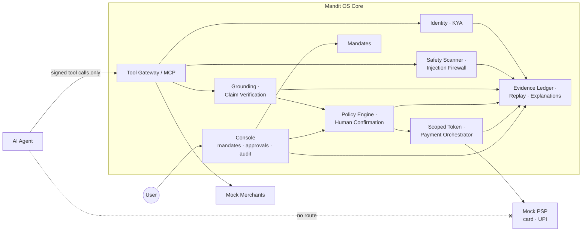

# Mandit OS

**A trust and security layer for agentic payments.**

Mandit OS is a mandatory authorization and evidence gateway for purchases initiated by AI agents. Before any money moves, it establishes:

- who the agent is;
- what the user actually authorized;
- whether the websites and tools involved are safe;
- whether the facts the agent relies on are true.

It then issues a narrowly scoped, single-use payment token and records a tamper-evident, replayable evidence trail for every decision.

> **Status:** Phase 1 (baseline) under active development. This is a research prototype that uses **synthetic data and simulated payment rails only**. It is not production-ready, it does not handle real funds, and it does not claim PCI compliance.

---

## The Problem

Autonomous agents now browse the web, compare prices and initiate payments for people. Existing payment security protects *credentials*. It does not protect *delegated authority*: the right of a non-human actor to spend a specific amount, at a specific place, for a specific purpose. An agent that reads a poisoned page, believes a hallucinated price, or is impersonated can move money while every credential remains technically valid.

The design rule of Mandit OS is that **security is enforced outside the model**, at the authorization and transaction boundary, because a prompt cannot protect money.

## Architecture



| Module | Purpose |
|---|---|
| Know Your Agent (KYA) | Verifiable agent identity, short-lived key-bound credentials, signed requests |
| Intent Mandate | User-signed constraints on what the agent may buy, where, for how much and until when |
| Web Safety Scanner | Domain, TLS and checkout-integrity risk |
| Prompt Injection Firewall | Detects hidden and AI-addressed instructions; labels all content as untrusted |
| Grounded Agent Intelligence | Verifies every money-relevant claim against authoritative sources; deterministic calculator; Trust Score; abstention |
| Policy Engine | Hard gates, step-up rules and Trust Score bands, resolved to ALLOW, STEP_UP, RETRIEVE_MORE or BLOCK |
| Human Confirmation | Signed approval bound to the exact proposal |
| Scoped Payment Token | Single-use token bound to merchant, payee, amount, currency, checkout and expiry |
| Evidence Ledger | Hash-chained, append-only evidence; deterministic replay; plain-language explanations |

The complete technical specification is in the [System Reference](docs/REFERENCE.md).

## Repository Layout

```
apps/console        Next.js console (mandates, confirmations, audit)
apps/demo-agent     Demonstration shopping agent
services/core       Mandit OS core (FastAPI modular monolith)
services/mock-*     Mock merchant and mock PSP (separate trust domains)
sdk/python          Agent SDK (request signing)
redteam/            Attack corpus, harness and reports
schemas/            Shared JSON Schemas
deploy/             Docker Compose and cloud manifests
docs/               Documentation
```

## Quick Start

```bash
git clone https://github.com/HeapifyGlobalCommunityy/Mandit-OS.git
cd Mandit-OS && git checkout develop
cp .env.example .env
make setup && make migrate && make seed
make dev          # console at http://localhost:3000, API at http://localhost:8000
make test
```

The `make` targets are introduced by the initial scaffolding pull request. See [CONTRIBUTING.md §4](CONTRIBUTING.md#4-getting-started).

## Documentation

| Audience | Start here |
|---|---|
| Every contributor | [CONTRIBUTING.md](CONTRIBUTING.md), [docs/REFERENCE.md](docs/REFERENCE.md) |
| Team 1: Identity and Mandate | [docs/modules/01-identity-and-mandate.md](docs/modules/01-identity-and-mandate.md) |
| Team 2: Safety Scanning | [docs/modules/02-safety-scanning.md](docs/modules/02-safety-scanning.md) |
| Team 3: Grounding and Verification | [docs/modules/03-grounding-and-verification.md](docs/modules/03-grounding-and-verification.md) |
| Team 4: Policy and Payments | [docs/modules/04-policy-and-payments.md](docs/modules/04-policy-and-payments.md) |
| Team 5: Evidence and Experience | [docs/modules/05-evidence-and-experience.md](docs/modules/05-evidence-and-experience.md) |
| Team 6: Red Team and Evaluation | [docs/modules/06-red-team-and-evaluation.md](docs/modules/06-red-team-and-evaluation.md) |
| Reviewers and auditors | [docs/THREAT_MODEL.md](docs/THREAT_MODEL.md), [docs/EVALUATION.md](docs/EVALUATION.md), [docs/adr/](docs/adr/) |
| Planning | [docs/ROADMAP.md](docs/ROADMAP.md), [docs/ASSUMPTIONS.md](docs/ASSUMPTIONS.md) |

The full index, including which documents must be updated for which kinds of change, is in [docs/README.md](docs/README.md).

## Contributing

All pull requests target the **`develop`** branch. Branch names follow `<type>/<module>/<short-description>` (for example `feature/mandates/matching-function`), and every pull request declares which other modules it affects, or states "No". See [CONTRIBUTING.md](CONTRIBUTING.md).

## Security

Do not report vulnerabilities in public issues. See [SECURITY.md](SECURITY.md).

## Code of Conduct

This project follows the [Code of Conduct](CODE_OF_CONDUCT.md).

## Licence

Licensed under the [Apache License 2.0](LICENSE).
