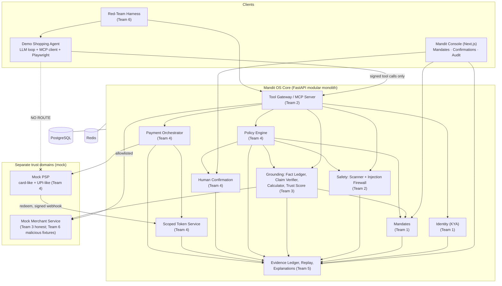
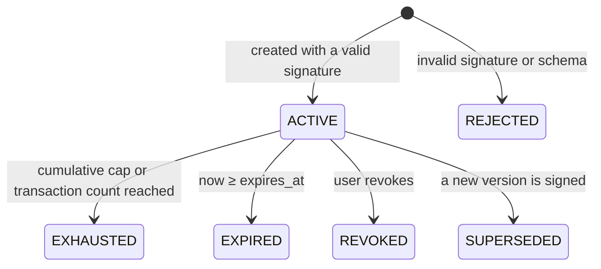
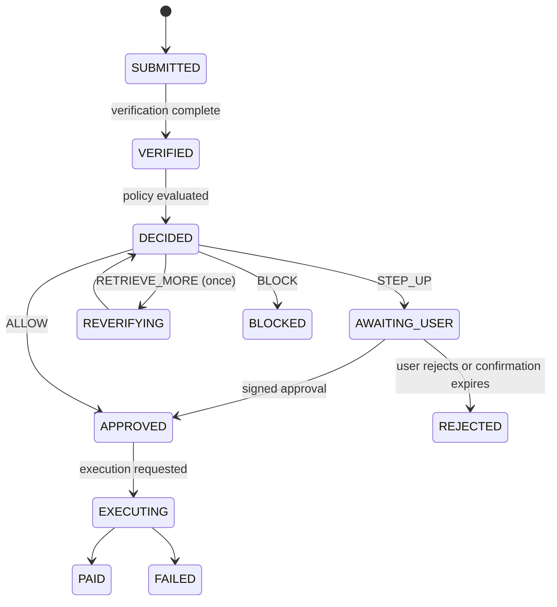

# Mandit OS System Reference

| Field | Value |
|---|---|
| Document status | Baseline v0.1 (Phase 1) |
| Last updated | 26 November 2026 |
| Applies to | All teams |
| Source documents | *Mandit OS: A Trust and Security Layer for Agentic Payments* (22-page brief); *Mandit OS PRD and Technical Architecture* v0.1, including Section 14, "Final Architecture Decisions (Approved)"; *Mandit OS Deep Dive* (20 November 2026) |
| Change control | Changes to this document require a pull request labelled `contract-change` and approval from at least two teams. See [CONTRIBUTING.md](../CONTRIBUTING.md). |

This document is the authoritative technical reference for Mandit OS. It covers the architecture, the end-to-end transaction pipeline, the conventions shared by every module, the endpoint catalogue, the decision model and the ownership boundaries between teams. The module documents in [`docs/modules/`](modules/) give the low-level specification for each team. Where a module document and this reference disagree, this reference prevails until the disagreement is resolved through the contract-change process.

---

## Table of Contents

1. [Purpose and Scope](#1-purpose-and-scope)
2. [Design Principles and Safety Invariants](#2-design-principles-and-safety-invariants)
3. [Architecture](#3-architecture)
4. [Team and Module Ownership](#4-team-and-module-ownership)
5. [Repository Layout](#5-repository-layout)
6. [End-to-End Transaction Pipeline](#6-end-to-end-transaction-pipeline)
7. [Shared Conventions](#7-shared-conventions)
8. [Authentication Models](#8-authentication-models)
9. [Endpoint Catalogue](#9-endpoint-catalogue)
10. [MCP Tool Surface](#10-mcp-tool-surface)
11. [Decision Model](#11-decision-model)
12. [State Machines](#12-state-machines)
13. [Core Data Entities](#13-core-data-entities)
14. [Cross-Team Dependency Matrix](#14-cross-team-dependency-matrix)
15. [Delivery Plan and Integration Gates](#15-delivery-plan-and-integration-gates)
16. [Phase Model: Baseline and Improvement](#16-phase-model-baseline-and-improvement)
17. [Related Documents](#17-related-documents)
18. [Appendices A–D](#appendix-a-glossary): glossary, error codes, threat model, Phase 3 directions

---

## 1. Purpose and Scope

Mandit OS is a mandatory trust layer that sits between a user, an AI agent acting for that user, the merchant and the payment rails. Before any money moves, it establishes:

1. **Who the agent is**: Know Your Agent (KYA) identity.
2. **What the user authorized**: the signed Intent Mandate.
3. **Whether the websites and tools involved are safe**: the Web Safety Scanner and Prompt Injection Firewall.
4. **Whether the facts the agent relies on are true**: grounding and claim verification.
5. **Whether the payment should proceed**: the Policy Engine and Human Confirmation.
6. **That the payment is narrowly scoped**: the Scoped Payment Token and the payment orchestrator.
7. **That every step is provable afterwards**: the Evidence Ledger and replay.

### 1.1 In scope for the programme

- A working prototype of the seven MVP components defined in the brief (Section 10.1).
- A demonstration shopping agent that reaches merchants only through Mandit OS tools.
- Mock merchant services (honest and malicious) and a mock PSP with card-like and UPI-like flows.
- A red-team corpus, an automated harness and an evaluation report.

### 1.2 Out of scope

- Real funds, real card data (PAN, CVV), bank credentials or real KYC.
- Claims of production readiness, PCI compliance or production-grade immutability.
- Direct integration with live merchants outside a controlled sandbox.

> **Synthetic data only.** Every user, merchant, card alias, VPA and transaction in this repository is synthetic. Contributions that introduce real personal or payment data are rejected. See the [README Security section](../README.md#security).

---

## 2. Design Principles and Safety Invariants

### 2.1 Design principles

| # | Principle | Practical meaning for contributors |
|---|---|---|
| P1 | Enforce outside the model | No safety property may depend on the agent behaving well. If a control reads "the agent will…" or "the prompt says…", it is not a control. |
| P2 | Untrusted by default | Web content, tool output and agent statements are data until a deterministic check verifies them. |
| P3 | Least privilege | Every tool, credential and token gets the smallest scope that works. |
| P4 | Deterministic checks before model opinions | Schemas, calculators and registries outrank language-model judgement. No LLM call is permitted inside the policy decision. |
| P5 | Abstain rather than guess | Low confidence or missing evidence leads to abstention, escalation or a block, never to a guess. |
| P6 | Evidence before action | A decision without a ledger entry is a defect. |
| P7 | Privacy by design | Agents receive opaque handles (`ship_to_ref`, `payment_ref`), not raw personal or payment data. |
| P8 | Fail closed | If a dependency (mandate store, registry, policy, ledger) is unavailable, the transaction is denied, never silently approved. |

### 2.2 Safety invariants (frozen at the Week 2 gate)

These invariants are not negotiable. Any change requires approval by all team leads.

| ID | Invariant |
|---|---|
| INV-01 | No valid signed mandate means no payment token. |
| INV-02 | No valid agent identity means no payment token. |
| INV-03 | A merchant, payee, amount, currency or proposal mismatch against the signed checkout and the mandate means no payment token. |
| INV-04 | A critical claim (product identity, payment amount, merchant legitimacy) that has not been verified can never lead to automatic execution. |
| INV-05 | A payment token is single-use and is bound to merchant, payee, amount, currency, checkout hash and expiry. |
| INV-06 | Money-relevant fields (`amount`, `currency`, `payee`, `merchant`) are always read from the merchant-signed checkout and never from agent-supplied or web-derived text. |
| INV-07 | A payment outside the mandate's scope cannot be made valid by human confirmation. It requires a new or amended signed mandate. |
| INV-08 | The Trust Score is evaluated only after the hard gates pass. It can never override a hard-gate BLOCK. |
| INV-09 | The agent never receives a payment credential, a payment token, a PAN, a CVV or a bank login. |
| INV-10 | Every ALLOW, STEP_UP, RETRIEVE_MORE and BLOCK decision produces a ledger event and a human-readable explanation. |
| INV-11 | Replaying a stored transaction with its frozen inputs and policy version reproduces the same decision. Replay never re-executes a payment. |
| INV-12 | There is no network route from the agent to the PSP. Only the payment orchestrator can call the PSP. |

---

## 3. Architecture

### 3.1 Logical architecture

Mandit OS is a **modular monolith** (one FastAPI application with strict internal module boundaries), plus separately deployed mock external services, a demonstration agent and a web console. This follows the approved PRD decision (Section 14).



### 3.2 Trust boundaries

| Boundary | Between | Rule |
|---|---|---|
| A | User and Console | The user authenticates to the console and signs mandates and approvals with a key only the user's browser controls. |
| B | Agent and browser/tool output, and the Gateway | All agent input and all content the agent reads is untrusted. It cannot authorize payment. |
| C | Policy and the Token Service | A token is minted only after a validated, signed ALLOW decision. |
| D | Token Service and the Mock PSP | Redemption validates every binding and is atomic and single-use. |
| E | Application and the Evidence Ledger | Application roles can only append to the ledger. Update and delete are denied at the database level. |

### 3.3 Deployment units

| Unit | Technology | Port (local) | Owner |
|---|---|---|---|
| `core` | Python 3.12, FastAPI | 8000 | All teams (module-scoped) |
| `worker` | Same codebase as `core`; background jobs (token expiry, reconciliation, ledger verification) | n/a | Team 4, Team 5 |
| `console` | Next.js (React, TypeScript) | 3000 | Team 1 (mandates), Team 4 (confirmations), Team 5 (audit) |
| `mock-merchant` | Python, FastAPI | 8100 | Team 3, with fixtures from Team 6 |
| `mock-psp` | Python, FastAPI, separate database and keys | 8200 | Team 4 |
| `demo-agent` | Python, MCP client, Playwright | n/a | Team 2, with scenarios from Team 6 |
| `postgres` | PostgreSQL 16 | 5432 | Shared |
| `redis` | Redis 7 | 6379 | Shared |

Local orchestration uses Docker Compose (`deploy/docker-compose.yml`). The cloud demo deploys the same containers behind an HTTPS ingress, with private managed PostgreSQL and Redis, and with secrets injected from a secrets manager.

### 3.4 Technology baseline

| Concern | Choice |
|---|---|
| Backend | Python 3.12, FastAPI, Pydantic v2, SQLAlchemy 2.x, Alembic |
| Frontend | Next.js 14+, TypeScript (strict), React; Node.js 24 LTS, pnpm 9+ |
| Data | PostgreSQL 16 (records, ledger); Redis 7 (nonces, rate limits, short-lived state) |
| Cryptography | Ed25519 (services, agents, merchants); ES256/ECDSA P-256 (user keys, Phase 1 via WebCrypto); SHA-256; RFC 8785 JSON Canonicalization Scheme (JCS) |
| Agent integration | Model Context Protocol (MCP) server exposed by the Gateway |
| Browser automation | Playwright |
| Testing | pytest, Hypothesis (property tests), Playwright Test, Jest/Vitest for the console |
| External lookups | RDAP, VirusTotal, Google Safe Browsing: optional, non-commercial, host names only ([module 02 §6.3](modules/02-safety-scanning.md#63-domain-lookups)) |
| Delivery | Docker, Docker Compose, CI on every pull request |

---

## 4. Team and Module Ownership

| Team | Modules owned | Primary question answered | Module document |
|---|---|---|---|
| Team 1: Identity and Mandate | KYA identity service, agent SDK signing helper, Intent Mandate service, mandate matching, mandate dashboard (console `/mandates`) | Who is acting, and what are they allowed to do? | [01-identity-and-mandate.md](modules/01-identity-and-mandate.md) |
| Team 2: Safety Scanning | Tool Gateway / MCP server, Web Safety Scanner, Prompt Injection Firewall, content records | Is this content and site safe, and is it trying to manipulate the agent? | [02-safety-scanning.md](modules/02-safety-scanning.md) |
| Team 3: Grounding and Verification | Mock merchant service (honest), merchant registry, proposals, Claim Verification Engine, Grounded Fact Ledger, deterministic calculator, Trust Score, abstention | Can we trust the facts the agent is using? | [03-grounding-and-verification.md](modules/03-grounding-and-verification.md) |
| Team 4: Policy and Payments | Policy Engine, Human Confirmation (service and console `/confirmations`), Scoped Token Service, Payment Orchestrator, Mock PSP | Should this payment happen, and how is it executed safely? | [04-policy-and-payments.md](modules/04-policy-and-payments.md) |
| Team 5: Evidence and Experience | Evidence Ledger, transactions, snapshots, replay, explanations, audit dashboard (console `/audit`) | Can every decision be proven and explained? | [05-evidence-and-experience.md](modules/05-evidence-and-experience.md) |
| Team 6: Red Team and Evaluation | Attack corpus, malicious merchant fixtures, test harness, metrics, demo scenarios, threat model upkeep | Does the system actually work? | [06-red-team-and-evaluation.md](modules/06-red-team-and-evaluation.md) |

### 4.1 Shared ownership

The following areas belong to every team. A change to any of them requires approvals from at least two teams.

- `services/core/mandit/common/`: identifiers, money, time, JCS, hashing, signatures, the error envelope, the event-emission client.
- `schemas/`: JSON Schemas for all shared entities.
- `deploy/` and CI configuration.
- This reference and the conventions in [CONTRIBUTING.md](../CONTRIBUTING.md).

The team should nominate a **technical lead and integration owner** (PRD Section 20, Developer 1). That person owns CI, the Compose environment and the integration gates.

### 4.2 Module boundary rules

1. Each module owns its own database tables, listed in its module document. No module reads or writes another module's tables directly.
2. Modules communicate in-process through the **service interfaces** published in each module document (Python `Protocol` classes in `mandit/<module>/interface.py`).
3. Modules communicate across processes (core, mock-merchant, mock-psp) only through the HTTP endpoints in [Section 9](#9-endpoint-catalogue).
4. A change to a published interface, endpoint, schema, event type or reason code is a **contract change** and follows the process in [CONTRIBUTING.md](../CONTRIBUTING.md#9-contract-changes).

---

## 5. Repository Layout

The structure below is the target layout. Directories are created by the first pull request that needs them.

```
Mandit-OS/
├── apps/
│   ├── console/                  # Next.js console
│   │   └── app/
│   │       ├── mandates/         # Team 1
│   │       ├── confirmations/    # Team 4
│   │       └── audit/            # Team 5
│   └── demo-agent/               # Demonstration shopping agent (Team 2 + Team 6)
├── services/
│   ├── core/
│   │   ├── mandit/
│   │   │   ├── common/           # Shared (ids, money, jcs, crypto, errors, events)
│   │   │   ├── identity/         # Team 1
│   │   │   ├── mandates/         # Team 1
│   │   │   ├── gateway/          # Team 2
│   │   │   ├── safety/           # Team 2
│   │   │   ├── grounding/        # Team 3
│   │   │   ├── policy/           # Team 4
│   │   │   ├── confirmation/     # Team 4
│   │   │   ├── tokens/           # Team 4
│   │   │   ├── payments/         # Team 4
│   │   │   └── evidence/         # Team 5
│   │   ├── migrations/           # Alembic; one linear history, one migration per change
│   │   └── tests/
│   ├── mock-merchant/            # Team 3 (+ Team 6 fixtures under fixtures/malicious/)
│   └── mock-psp/                 # Team 4
├── sdk/
│   └── python/mandit_sdk/        # Team 1 (request signing, typed client)
├── redteam/                      # Team 6
│   ├── corpus/
│   ├── harness/
│   └── scenarios/
├── schemas/                      # Shared JSON Schemas (versioned)
├── deploy/                       # Docker Compose, cloud manifests
├── docs/
└── .github/
```

Each module directory contains `interface.py` (the published service interface), `api.py` (HTTP routes), `service.py`, `models.py`, `schemas.py` and a `README.md` with the module's local design notes.

---

## 6. End-to-End Transaction Pipeline

### 6.1 Sequence

```mermaid
sequenceDiagram
    autonumber
    actor U as User
    participant C as Console
    participant MD as Mandates (T1)
    participant ID as Identity/KYA (T1)
    participant A as Demo Agent
    participant GW as Tool Gateway (T2)
    participant SF as Safety (T2)
    participant MM as Mock Merchant (T3)
    participant GR as Grounding (T3)
    participant PO as Policy (T4)
    participant HC as Confirmation (T4)
    participant PY as Payments + Tokens (T4)
    participant PSP as Mock PSP (T4)
    participant EV as Evidence (T5)

    U->>C: Create mandate (limits, merchants, expiry, threshold)
    C->>C: Sign canonical mandate with the user key
    C->>MD: POST /v1/mandates
    MD->>EV: MANDATE_CREATED

    A->>ID: POST /v1/agents/{id}/challenge, then /token
    ID-->>A: KYA JWT (15 min, bound to the agent key)
    ID->>EV: AGENT_CREDENTIAL_ISSUED

    A->>GW: POST /v1/transactions (mandate_id) [signed]
    GW->>EV: TRANSACTION_OPENED

    A->>GW: tool merchant.search / web.fetch [signed]
    GW->>ID: verify_request()
    GW->>MM: fetch (allowlisted)
    GW->>SF: inspect(content)
    SF->>EV: CONTENT_SEEN, SITE_SCANNED, INJECTION_DETECTED?
    GW-->>A: Results wrapped as UNTRUSTED data

    A->>GW: tool merchant.create_checkout
    GW->>MM: POST checkouts
    MM-->>GW: Merchant-signed checkout
    GW->>GR: store checkout snapshot
    GR->>EV: CHECKOUT_SNAPSHOT

    A->>GW: tool purchase.propose
    GW->>GR: create proposal, then verify
    GR->>MD: match(mandate, proposed action)
    GR->>SF: risk for sources
    GR->>EV: PROPOSAL_SUBMITTED, CLAIM_VERIFIED*, TRUST_SCORE_COMPUTED
    GW->>PO: evaluate(proposal)
    PO->>EV: DECISION_MADE

    alt BLOCK
        GW-->>A: BLOCKED (reason class)
    else STEP_UP
        PO->>HC: create confirmation
        HC->>EV: STEP_UP_REQUESTED
        U->>C: Review the Mandit-rendered cart; sign approval
        C->>HC: POST /v1/confirmations/{id}/respond
        HC->>PO: re-evaluate with the approval
        PO->>EV: DECISION_MADE (ALLOW via confirmation)
    else RETRIEVE_MORE (once)
        PO->>GR: verify(refresh=true), then re-evaluate
    end

    A->>GW: tool purchase.request_execution
    GW->>PY: execute(proposal_id)
    PY->>MM: re-fetch checkout (TOCTOU check)
    PY->>MD: reserve_spend()
    PY->>PY: issue scoped token
    PY->>EV: TOKEN_ISSUED
    PY->>PSP: create scoped credential / UPI intent
    PSP->>PY: POST /v1/payment-tokens/redeem (atomic)
    PSP-->>PY: AUTHORIZED / CAPTURED (signed webhook)
    PY->>EV: TOKEN_REDEEMED, PAYMENT_RESULT
    EV->>EV: EXPLANATION_GENERATED
    GW-->>A: PAID (receipt reference)
    U->>C: View the audit trail and explanation
```

### 6.2 Hop table

| # | Hop | Owner | Checks performed | State written | Ledger event(s) |
|---|---|---|---|---|---|
| 1 | User creates and signs a mandate | T1 | Schema; signature over `sha256(JCS(mandate))`; expiry in the future; agent exists and is active | `mandates` (ACTIVE) | `MANDATE_CREATED` or `MANDATE_REJECTED` |
| 2 | Agent obtains credentials | T1 | Agent and operator active; challenge signature valid | `agent_credentials` | `AGENT_CREDENTIAL_ISSUED` |
| 3 | Agent opens a transaction | T5 (via T2) | Signed request; mandate ACTIVE and bound to this agent | `transactions` | `TRANSACTION_OPENED` |
| 4 | Agent calls a read tool | T2 | Request signature, nonce, timestamp, scope, mandate active, merchant/domain allowlisted, rate limit | `tool_calls` | `TOOL_CALL_RECEIVED` or `TOOL_CALL_DENIED` |
| 5 | Gateway fetches and scans content | T2 | Site risk, TLS, look-alike domains, hidden text, AI-addressed instructions, payment-field overrides | `content_records`, `scan_reports` | `CONTENT_SEEN`, `SITE_SCANNED`, `INJECTION_DETECTED` |
| 6 | Agent creates a checkout | T2 → T3 | Merchant allowlisted; items schema; quantity bounds; merchant signature on the response | `checkouts` | `CHECKOUT_SNAPSHOT` |
| 7 | Agent proposes a purchase | T3 | Schema; checkout exists and is unexpired; agent-supplied money fields are recorded as claims, never trusted | `proposals` (SUBMITTED) | `PROPOSAL_SUBMITTED` |
| 8 | Claim verification | T3 | Claims vs catalog, checkout, registry and mandate; deterministic recompute; freshness | `claims`, `facts`, `verifications` | `CLAIM_VERIFIED` (per claim), `VERIFICATION_COMPLETED`, `TRUST_SCORE_COMPUTED`, `ABSTENTION_RAISED` |
| 9 | Policy decision | T4 | Hard gates, then step-up rules, then Trust Score bands | `decisions` | `DECISION_MADE` |
| 10 | Step-up (if required) | T4 | Approval signature over the challenge; proposal hash unchanged; not expired | `confirmations` | `STEP_UP_REQUESTED`, `CONFIRMATION_APPROVED`, `CONFIRMATION_REJECTED` or `CONFIRMATION_EXPIRED` |
| 11 | Execution request | T4 | Decision is ALLOW and unexpired; checkout re-fetched with an equal hash; mandate still active; spend reserved atomically | `payments`, `payment_tokens` | `TOKEN_ISSUED` or `TOKEN_ISSUE_REFUSED` |
| 12 | PSP redemption | T4 | Atomic compare-and-set on the token; binding equality; idempotency | `payment_tokens` (REDEEMED), `payments` | `TOKEN_REDEEMED` or `TOKEN_REDEMPTION_REJECTED`, `PAYMENT_RESULT` |
| 13 | Explanation and receipt | T5 | Explanation generated only from the decision record | `explanations` | `EXPLANATION_GENERATED` |

### 6.3 Pipelines by concern

| Pipeline | Stages | Owners |
|---|---|---|
| Authorization foundation | Operator → Agent → Credential → Mandate → Mandate binding | T1 |
| Content intake | Tool call → Identity verification → Fetch → Site scan → Injection scan → Wrap as untrusted → Record | T2 (with T1, T5) |
| Fact grounding | Checkout snapshot → Proposal → Claim building → Per-claim verification → Calculator reconciliation → Fact Ledger → Trust Score → Abstentions | T3 (with T1, T2, T5) |
| Decision | Gather inputs → Freeze inputs (snapshot) → Hard gates → Step-up rules → Trust bands → Decision record → Confirmation (optional) | T4 (with T3, T5) |
| Execution | Re-validate → Reserve spend → Issue token → PSP primitive → Redeem → Reconcile → Release or commit spend | T4 (with T1, T5) |
| Evidence | Append event → Hash chain → Snapshot → Explain → Verify chain → Replay → Export bundle | T5 (with all) |
| Evaluation | Scenario → Harness run → Assertions on decision, token and ledger → Metrics with confidence intervals → Report | T6 (with all) |

---

## 7. Shared Conventions

These conventions are implemented once in `mandit/common/` and must be used by every module. Reimplementing them inside a module is a review-blocking defect.

### 7.1 Identifiers

Identifiers are prefixed ULIDs: `<prefix>_<26-character ULID>`, for example `man_01JD3X7Q9Z8K4M2N6P0R5S7T1V`.

| Prefix | Entity | Owner |
|---|---|---|
| `usr_` | User | T1 |
| `ukey_` | User signing key | T1 |
| `op_` | Operator | T1 |
| `agt_` | Agent | T1 |
| `akey_` | Agent key | T1 |
| `man_` | Mandate | T1 |
| `txn_` | Transaction (evidence correlation root) | T5 |
| `tc_` | Tool call | T2 |
| `cnt_` | Content record | T2 |
| `scn_` | Scan report | T2 |
| `mer_` | Merchant | T3 |
| `co_` | Checkout | T3 (mock merchant) |
| `prop_` | Proposal | T3 |
| `clm_` | Claim | T3 |
| `fact_` | Grounded fact | T3 |
| `ver_` | Verification report | T3 |
| `dec_` | Decision | T4 |
| `cnf_` | Confirmation | T4 |
| `ptok_` | Payment token | T4 |
| `pay_` | Payment | T4 |
| `evt_` | Ledger event | T5 |
| `snap_` | Snapshot | T5 |
| `rpl_` | Replay record | T5 |

Fixture identifiers in tests and demo data may use readable ULID-shaped suffixes (for example `mer_croma_demo`). Production code must not depend on the format of the suffix.

### 7.2 Money

- Amounts are **integers in minor units** (paise for INR, cents for USD), in fields named `*_minor`.
- Every amount travels with an explicit ISO 4217 `currency` field.
- Floating-point types are never used for money, in any language or in the database (`BIGINT` only).
- Formatting for display (for example `₹1,49,999`) happens only in the console and in explanation templates, through `common.money.format_minor(amount_minor, currency, locale)`.


### 7.3 Time

- All timestamps are RFC 3339 strings in UTC with a `Z` suffix and millisecond precision, for example `2026-11-23T10:15:30.123Z`.
- JWT claims (`iat`, `exp`, `nbf`) use Unix seconds, per the JWT specification.
- Server time is authoritative. Clock-skew tolerance for signed agent requests is ±60 seconds.

### 7.4 Canonicalization, hashing and signatures

| Operation | Rule |
|---|---|
| Canonical bytes | RFC 8785 JCS over the object, with the `signature` field (if any) removed. |
| Hash format | `sha256:<lowercase hex>` |
| Service, agent and merchant signatures | Ed25519. Detached signatures are base64url without padding. JWTs use `alg: EdDSA`. |
| User signatures (Phase 1) | ECDSA P-256 / SHA-256 (`ES256`) produced by a non-extractable WebCrypto key in the console. |
| User signatures (Phase 2) | WebAuthn passkey assertion whose `challenge` is the object digest. |
| Signature envelope | `{"alg": "...", "key_id": "...", "signed_digest": "sha256:...", "value": "<base64url>"}` |

Helpers: `common.jcs.canonicalize(obj) -> bytes`, `common.hashing.digest(obj) -> str`, `common.crypto.sign(key_id, digest)`, `common.crypto.verify(envelope, obj) -> bool`.

### 7.5 HTTP conventions

| Header | Direction | Required | Purpose |
|---|---|---|---|
| `X-Request-ID` | Request and response | Yes (generated if absent) | Correlates logs and traces |
| `Mandit-Transaction-ID` | Request | Yes, for all agent calls after the transaction is opened | Correlates evidence |
| `Idempotency-Key` | Request | Yes, for every mutating payment, token, confirmation and proposal request | Deduplicates retries |
| `Authorization` | Request | Yes | `KYA <jwt>` for agents; `Bearer <session-jwt>` for console users; `Service <jwt>` for service-to-service calls |
| `Content-Digest`, `Signature-Input`, `Signature` | Request | Yes, for agent calls | RFC 9421 HTTP Message Signatures |

Idempotency semantics: a repeated request with the same `Idempotency-Key` and the same body returns the original response with status `200` and header `Idempotent-Replayed: true`. The same key with a different body returns `409 IDEMPOTENCY_CONFLICT`. Keys are retained for 24 hours.

API versioning: public routes are prefixed with `/v1`. Breaking changes require `/v2` routes and a deprecation period agreed by the affected teams. Internal service-to-service routes are prefixed with `/internal/v1`.

### 7.6 Error envelope

Every non-2xx response uses this body:

```json
{
  "error": {
    "code": "MANDATE_EXPIRED",
    "message": "The mandate expired at 2026-11-22T06:30:00.000Z.",
    "request_id": "req_01JD3XA1B2C3D4E5F6G7H8J9K0",
    "details": {
      "mandate_id": "man_01JD3X7Q9Z8K4M2N6P0R5S7T1V"
    }
  }
}
```

| HTTP status | Use |
|---|---|
| 400 | `VALIDATION_ERROR` and malformed input |
| 401 | Missing or invalid authentication (`UNAUTHENTICATED`, `SIGNATURE_INVALID`, `KYA_TOKEN_EXPIRED`) |
| 403 | Authenticated but not permitted (`SCOPE_DENIED`, `AGENT_REVOKED`, `MERCHANT_NOT_ALLOWED` at the gateway) |
| 404 | Resource not found |
| 409 | State conflict (`IDEMPOTENCY_CONFLICT`, `TOKEN_ALREADY_REDEEMED`, `CONFIRMATION_PROPOSAL_CHANGED`) |
| 410 | Expired resources (`MANDATE_EXPIRED`, `TOKEN_EXPIRED`, `CONFIRMATION_EXPIRED`) |
| 422 | Semantically valid input that a business rule rejects |
| 429 | `RATE_LIMITED` |
| 503 | `DEPENDENCY_UNAVAILABLE`, returned fail-closed |

A policy **decision** of BLOCK is not an HTTP error. `POST /v1/proposals/{id}/evaluate` returns `200` with `outcome: "BLOCK"`. HTTP errors are reserved for requests that could not be processed.

All reason and error codes are registered in [REFERENCE Appendix B](#appendix-b-error-and-reason-codes). A code that is not registered there must not be emitted.

**Agent-facing disclosure.** Detailed reasons are written to the ledger and shown to the user. Responses to the agent carry only a coarse `reason_class` (`IDENTITY`, `MANDATE`, `SAFETY`, `VERIFICATION`, `POLICY`, `PAYMENT`) and a `user_action_required` flag. This keeps an attacker from probing for the exact field that caused a rejection.

### 7.7 Ledger events

Every state change of significance emits an event through `common.events.emit(...)`, which delegates to the Evidence module. Event types, producers and payload schemas are registered in [module 05 §12](modules/05-evidence-and-experience.md#12-ledger-event-catalogue). Section 5 of the [Evidence module document](modules/05-evidence-and-experience.md) defines the envelope.

Rule: **the database write that records a decision or state change and the ledger append happen in the same database transaction**, or through the transactional outbox provided by `common.events`. A decision without evidence must not exist.

### 7.8 Logging and observability

- Structured JSON logs with `request_id`, `transaction_id`, `module` and `event`.
- Never log secrets, private keys, full JWTs, signatures, payment tokens or personal data. `common.logging` redacts known sensitive keys.
- Metrics (Prometheus format): request latency per route, decision outcome counts, token issue and redeem counts, scanner hit counts, ledger append latency.
- Traces span request → verification → policy → token → PSP, linked by `transaction_id`.

---

## 8. Authentication Models

### 8.1 Agents (KYA)

1. An operator registers an agent with an Ed25519 public key (JWK).
2. The agent runtime (never the LLM) proves possession of the key through a challenge and receives a **KYA JWT**. The JWT is valid for at most 15 minutes and carries `cnf.jkt`, the thumbprint of the agent key.
3. Every agent request is signed per RFC 9421 over `@method`, `@target-uri`, `content-digest`, `authorization` and `mandit-transaction-id`, with the signature parameters `created`, `nonce`, `keyid` and `alg`.
4. The gateway verifies, in order: the JWT signature and the pinned `alg`; `exp` and `nbf`; `aud`; agent and operator status; the HTTP signature against the key whose thumbprint equals `cnf.jkt`; `created` within ±60 seconds; nonce unseen (Redis `SET NX EX 300`); `Content-Digest` against the body; and the tool scope.

The full specification is in [01-identity-and-mandate.md §5](modules/01-identity-and-mandate.md#5-agent-authentication-protocol).

### 8.2 Console users

Phase 1 uses seeded synthetic users with a password login, which issues an HTTP-only session cookie and a short-lived `Bearer` session JWT for API calls. Each user holds a signing key pair generated in the browser (WebCrypto, non-extractable, stored in IndexedDB). The public key is registered at `POST /v1/users/me/keys`. Mandates and confirmations are signed with this key. Phase 2 replaces the key with a WebAuthn passkey.

### 8.3 Services

Service-to-service calls, from the mock PSP to the token service and from core to the mock merchant, use a `Service <jwt>` header. The JWT is signed with the calling service's Ed25519 key, has `aud` set to the target service, and is valid for at most 5 minutes. Webhooks from the mock PSP carry a `Mock-PSP-Signature` header over the JCS body, plus an `event_id` for replay prevention.

---

## 9. Endpoint Catalogue

This catalogue lists every endpoint. Request and response bodies are specified in the owning module document. **Auth** values: `AGENT` (KYA plus HTTP signature), `USER` (console session), `SERVICE` (service JWT), `PUBLIC` (no authentication; read-only).

### 9.1 Team 1: Identity and Mandate

| Method | Path | Auth | Purpose |
|---|---|---|---|
| POST | `/v1/operators` | USER (admin) | Register an operator |
| GET | `/v1/operators/{operator_id}` | USER (admin) | Read an operator |
| POST | `/v1/operators/{operator_id}/verify` | USER (admin) | Mark an operator VERIFIED (Phase 1 manual KYB) |
| POST | `/v1/agents/register` | USER (operator admin) | Register an agent and its public key |
| GET | `/v1/agents/{agent_id}` | USER, SERVICE | Read an agent and its status |
| POST | `/v1/agents/{agent_id}/challenge` | PUBLIC | Obtain a proof-of-possession challenge |
| POST | `/v1/agents/{agent_id}/token` | PUBLIC (challenge-signed) | Exchange a signed challenge for a KYA JWT |
| POST | `/v1/agents/{agent_id}/keys` | USER (operator admin) | Add a new key (rotation) |
| POST | `/v1/agents/{agent_id}/keys/{key_id}/retire` | USER (operator admin) | Retire an old key |
| POST | `/v1/agents/{agent_id}/revoke` | USER (operator admin or Mandit admin) | Revoke an agent |
| GET | `/.well-known/mandit/jwks.json` | PUBLIC | Mandit KYA issuer public keys |
| GET | `/.well-known/mandit/agents/{agent_id}.jwks` | PUBLIC | Agent directory: active public keys |
| GET | `/v1/revocations` | PUBLIC | Revoked agents and keys since a given time |
| POST | `/v1/users/me/keys` | USER | Register a user signing public key |
| POST | `/v1/mandates` | USER | Create a signed mandate |
| GET | `/v1/mandates` | USER | List the user's mandates |
| GET | `/v1/mandates/{mandate_id}` | USER, AGENT (bound agent only), SERVICE | Read a mandate |
| POST | `/v1/mandates/{mandate_id}/revoke` | USER | Revoke a mandate |
| POST | `/v1/mandates/{mandate_id}/match` | SERVICE | Match a proposed action against the mandate |

### 9.2 Team 2: Safety Scanning and Gateway

| Method | Path | Auth | Purpose |
|---|---|---|---|
| POST | `/mcp` | AGENT | MCP server endpoint (streamable HTTP) exposing the tools in [Section 10](#10-mcp-tool-surface) |
| POST | `/v1/gateway/tools/{tool_name}` | AGENT | REST mirror of each MCP tool, for SDK use and testing |
| POST | `/v1/content/inspect` | SERVICE | Scan a URL or raw content and return the combined safety report |
| GET | `/v1/content/{content_id}` | USER, SERVICE | Read a content record and its scan results |
| POST | `/v1/safety/site-scan` | SERVICE | Domain, TLS and checkout-integrity scan only |
| POST | `/v1/safety/injection-scan` | SERVICE | Injection scan only, on supplied content |
| GET | `/v1/safety/domain-info?domain=` | SERVICE | Registry entry, registration data and reputation of a domain |
| GET | `/v1/safety/risk` | SERVICE | Aggregated risk for a list of `content_id` values and a merchant domain |

### 9.3 Team 3: Grounding and Verification

| Method | Path | Auth | Purpose |
|---|---|---|---|
| GET | `/v1/merchants/{merchant_id}` | SERVICE, USER | Merchant registry entry |
| GET | `/v1/merchants?domain=` | SERVICE | Resolve a domain to a registered merchant |
| POST | `/v1/checkouts/snapshots` | SERVICE | Store a merchant-signed checkout snapshot (called by the gateway) |
| POST | `/v1/proposals` | SERVICE (from the gateway) | Create a purchase proposal |
| GET | `/v1/proposals/{proposal_id}` | AGENT (owner), USER, SERVICE | Read a proposal and its status |
| POST | `/v1/proposals/{proposal_id}/verify` | SERVICE | Run claim verification and compute the Trust Score |
| GET | `/v1/proposals/{proposal_id}/verification` | USER, SERVICE | Read the latest verification report |
| GET | `/v1/facts/{fact_id}` | USER, SERVICE | Read a Grounded Fact Ledger entry |

**Mock merchant service** (separate deployable; base URL `http://mock-merchant:8100/merchants/{merchant_id}`):

| Method | Path | Purpose |
|---|---|---|
| GET | `/v1/catalog/products?q=&category=&limit=` | Search the catalog |
| GET | `/v1/catalog/products/{sku}` | Product detail |
| POST | `/v1/checkouts` | Create a signed checkout |
| GET | `/v1/checkouts/{checkout_id}` | Re-fetch a signed checkout (TOCTOU revalidation) |
| POST | `/v1/checkouts/{checkout_id}/complete` | Record payment completion (`psp_payment_id`) |
| GET | `/v1/policies` | Returns, delivery and warranty policy (structured) |
| GET | `/.well-known/merchant-keys.json` | Merchant signing public keys |
| GET | `/storefront/...` | HTML storefront pages for the browser path |

### 9.4 Team 4: Policy and Payments

| Method | Path | Auth | Purpose |
|---|---|---|---|
| POST | `/v1/proposals/{proposal_id}/evaluate` | SERVICE | Run the policy decision |
| GET | `/v1/decisions/{decision_id}` | USER, SERVICE | Read a decision |
| GET | `/v1/confirmations` | USER | List pending confirmations for the user |
| GET | `/v1/confirmations/{confirmation_id}` | USER | Read the confirmation display payload and challenge |
| POST | `/v1/confirmations/{confirmation_id}/respond` | USER | Submit a signed approval or rejection |
| POST | `/v1/payments/execute` | SERVICE (from the gateway) | Re-validate, issue a token and execute the payment |
| GET | `/v1/payments/{payment_id}` | AGENT (owner), USER, SERVICE | Payment status |
| POST | `/v1/payments/webhooks/mock-psp` | Signed webhook | PSP status callbacks |
| POST | `/v1/payment-tokens/redeem` | SERVICE (mock PSP) | Atomically validate and consume a token |
| POST | `/v1/payment-tokens/validate` | SERVICE | Validate without consuming |
| GET | `/v1/payment-tokens/{token_id}` | USER, SERVICE | Token status (never the token value) |
| POST | `/v1/payment-tokens/{token_id}/revoke` | SERVICE, USER (admin) | Revoke an unredeemed token |

**Mock PSP** (separate deployable; base URL `http://mock-psp:8200`):

| Method | Path | Purpose |
|---|---|---|
| POST | `/psp/v1/card/scoped-credentials` | Create a seller-bound, amount-capped, expiring credential from a Mandit token |
| POST | `/psp/v1/card/authorize` | Authorize against a scoped credential (idempotent) |
| POST | `/psp/v1/card/capture` | Capture up to the authorized amount |
| POST | `/psp/v1/upi/intents` | Create a UPI-style collect intent bound to a payee VPA |
| POST | `/psp/v1/upi/intents/{intent_id}/approve` | Simulated payer approval |
| POST | `/psp/v1/upi/intents/{intent_id}/decline` | Simulated payer decline |
| GET | `/psp/v1/payments/{psp_payment_id}` | Status (used for reconciliation) |
| GET | `/.well-known/psp-keys.json` | PSP webhook-signing public keys |
| POST | `/psp/v1/admin/faults` | Test-only fault injection (disabled outside the `test` and `demo` profiles) |

### 9.5 Team 5: Evidence and Experience

| Method | Path | Auth | Purpose |
|---|---|---|---|
| POST | `/v1/transactions` | AGENT (through the gateway) | Open a transaction under a mandate |
| GET | `/v1/transactions` | USER | List transactions (filters: status, outcome, date, merchant) |
| GET | `/v1/transactions/{transaction_id}` | USER | Transaction summary |
| POST | `/internal/v1/evidence/events` | SERVICE | Append an event (out-of-process producers) |
| GET | `/v1/evidence/{transaction_id}` | USER | Full ordered event chain for a transaction |
| GET | `/v1/evidence/{transaction_id}/verify` | USER | Verify the hash chain and signatures for the transaction |
| POST | `/v1/evidence/{transaction_id}/replay` | USER | Deterministically replay the decision from frozen inputs |
| GET | `/v1/evidence/{transaction_id}/explanation` | USER | Human-readable explanation |
| GET | `/v1/evidence/{transaction_id}/bundle` | USER | Exportable evidence bundle (JSON) |
| GET | `/v1/ledger/verify` | USER (auditor) | Verify the full chain, or a sequence range of it |

---

## 10. MCP Tool Surface

The Tool Gateway exposes **only** the following tools to agents. No generic HTTP, shell, form-filling, email, wallet or raw payment tools are exposed in a session that holds payment capability.

| Tool | Required KYA scope | Effect | Backing module |
|---|---|---|---|
| `transaction.open(mandate_id)` | `transaction:open` | Opens a transaction; returns `transaction_id` | T5 |
| `merchant.search(merchant_id?, query, category?, limit?)` | `merchant:read` | Structured search across allowlisted merchants | T2 → mock merchant |
| `merchant.get_product(merchant_id, sku)` | `merchant:read` | Product detail (structured fields) | T2 → mock merchant |
| `web.fetch(url)` | `web:fetch` | Fetches a page through Playwright; returns scanned, untrusted text | T2 |
| `merchant.create_checkout(merchant_id, items[], ship_to_ref, payment_method)` | `checkout:create` | Creates a merchant-signed checkout; snapshot stored | T2 → mock merchant → T3 |
| `purchase.propose(checkout_id, ...)` | `purchase:propose` | Creates, verifies and evaluates a proposal | T3, T4 |
| `purchase.status(proposal_id)` | `purchase:read` | Returns the proposal and decision status | T3, T4 |
| `purchase.request_execution(proposal_id)` | `purchase:execute` | Executes an allowed proposal; returns the payment status | T4 |
| `user.ask(question)` | `user:ask` | Sends a clarification request to the user through the console (Phase 2) | T4 |

Every tool response carries a uniform status shape:

```json
{
  "status": "OK | DENIED | BLOCKED | NEEDS_USER | PENDING | PAID | FAILED",
  "reason_class": null,
  "user_action_required": false,
  "data": {},
  "provenance": {
    "content_id": "cnt_...",
    "trust": "UNTRUSTED"
  }
}
```

---

## 11. Decision Model

The Policy Engine (Team 4) evaluates in three ordered stages. The final outcome is the **most restrictive** outcome produced by any stage, with precedence `BLOCK > RETRIEVE_MORE > STEP_UP > ALLOW`. The Trust Score is advisory and is consulted only when no hard gate has fired.

### 11.1 Stage 1: Hard gates (any failure results in BLOCK)

| Rule | Condition for BLOCK | Reason code(s) | Input source |
|---|---|---|---|
| HG-01 | Agent identity invalid, revoked or not bound | `AGENT_REVOKED`, `KYA_TOKEN_INVALID`, `KEY_NOT_BOUND` | T1 |
| HG-02 | Mandate invalid, expired, revoked, superseded, exhausted, or not bound to this agent | `MANDATE_*`, `AGENT_NOT_BOUND_TO_MANDATE` | T1 |
| HG-03 | Merchant or domain not in the mandate allowlist | `MERCHANT_NOT_ALLOWED`, `DOMAIN_NOT_ALLOWED` | T1 |
| HG-04 | Merchant not in the registry, merchant suspended, or payee differs from the registry payee | `MERCHANT_NOT_IN_REGISTRY`, `MERCHANT_SUSPENDED`, `PAYEE_MISMATCH` | T3 |
| HG-05 | Checkout signature invalid, or checkout expired | `CHECKOUT_SIGNATURE_INVALID`, `CHECKOUT_EXPIRED` | T3 |
| HG-06 | Currency differs from the mandate currency | `CURRENCY_MISMATCH` | T1 |
| HG-07 | Total exceeds the per-transaction cap | `OVER_TXN_CAP` | T1 |
| HG-08 | Cumulative spend or transaction count would exceed the mandate | `OVER_TOTAL_CAP`, `TXN_COUNT_EXCEEDED` | T1 |
| HG-09 | Deterministic recompute differs from the merchant total | `TOTAL_RECOMPUTE_MISMATCH` | T3 |
| HG-10 | Agent-stated amount, currency or merchant differs from the signed checkout | `AGENT_AMOUNT_MISMATCH`, `AGENT_MERCHANT_MISMATCH` | T3 |
| HG-11 | Forbidden line type present, or a product category not allowed | `FORBIDDEN_LINE_TYPE`, `CATEGORY_NOT_ALLOWED` | T1 |
| HG-12 | A critical claim (product identity, payment amount, merchant legitimacy) is not VERIFIED | `PRODUCT_UNVERIFIED`, `AMOUNT_UNVERIFIED`, `MERCHANT_UNVERIFIED` | T3 |
| HG-13 | Payment method not allowed by the mandate | `PAYMENT_METHOD_NOT_ALLOWED` | T1 |
| HG-14 | High-severity injection found in a source referenced by the proposal | `INJECTION_DETECTED_HIGH` | T2 |
| HG-15 | Merchant domain site risk is HIGH | `SITE_RISK_HIGH` | T2 |
| HG-16 | A stated delivery or returns term violates a mandate requirement | `DELIVERY_REQUIREMENT_UNMET`, `RETURNS_REQUIREMENT_UNMET` | T1 |

### 11.2 Stage 2: Step-up rules (any match results in STEP_UP)

| Rule | Condition | Reason code |
|---|---|---|
| SU-01 | Total ≥ the mandate `approval_threshold_minor` | `ABOVE_APPROVAL_THRESHOLD` |
| SU-02 | First purchase by this user from this merchant | `NEW_MERCHANT_FOR_USER` |
| SU-03 | Merchant domain site risk is MEDIUM | `SITE_RISK_MEDIUM` |
| SU-04 | Medium-severity injection in a referenced source | `INJECTION_DETECTED_MEDIUM` |
| SU-05 | The displayed (page) price differs from the catalog price, or the price claim is unverifiable | `PRICE_MISMATCH`, `PRICE_UNVERIFIED` |
| SU-06 | Delivery or returns term unverifiable while the mandate requires it | `DELIVERY_UNVERIFIED`, `RETURNS_UNVERIFIED` |
| SU-07 | The agent chose a pricier item than a cheaper item it saw that matches every mandate constraint | `PRICIER_ALTERNATIVE_CHOSEN` |

### 11.3 Stage 3: Trust Score bands

`TrustScore = w1·G + w2·C + w3·S + w4·R + w5·P`. All components lie in [0, 1], higher means safer, and the weights sum to 1. Team 3 defines and computes the components ([03-grounding-and-verification.md §8](modules/03-grounding-and-verification.md#8-trust-score)).

| Band | Outcome |
|---|---|
| 0.90 – 1.00 | ALLOW |
| 0.70 – 0.89 | STEP_UP (`TRUST_SCORE_STEP_UP`) |
| 0.50 – 0.69 | RETRIEVE_MORE (`TRUST_SCORE_RETRIEVE_MORE`): Team 3 re-verifies with fresh sources, once. If the band is unchanged on the second evaluation, the outcome is STEP_UP (`RETRIEVE_MORE_EXHAUSTED`). |
| < 0.50 | BLOCK (`TRUST_SCORE_BLOCK`) and an incident is logged |

Phase 1 initial weights (version `trust-1.0.0`): G = 0.30, C = 0.15, S = 0.20, R = 0.10, P = 0.25. Team 6 tunes them in Week 9 on held-out data. Each change is recorded with a new `trust_model_version`.

### 11.4 Decision versioning

Every decision records `policy_version` (for example `policy-1.0.0`), `trust_model_version`, `inputs_hash` (the digest of the frozen inputs snapshot), the full list of `rules_fired`, and the final `outcome`. The policy function is pure, so the same inputs and the same version always produce the same output (INV-11).

---

## 12. State Machines

### 12.1 Mandate



### 12.2 Proposal



### 12.3 Confirmation

`PENDING → APPROVED | REJECTED | EXPIRED | INVALIDATED`. A confirmation is INVALIDATED if the proposal hash or the checkout hash changes.

### 12.4 Payment token

```mermaid
stateDiagram-v2
    [*] --> ISSUED: ALLOW decision and spend reserved
    ISSUED --> REDEEMING: atomic compare-and-set on redeem
    REDEEMING --> REDEEMED: PSP authorized or captured
    REDEEMING --> FAILED: PSP declined; token burned
    REDEEMING --> UNKNOWN: timeout or lost response
    UNKNOWN --> REDEEMED: reconciled through the PSP status API or webhook
    UNKNOWN --> FAILED: reconciliation shows no charge
    ISSUED --> EXPIRED: now ≥ exp
    ISSUED --> REVOKED: mandate revoked or checkout changed
```



### 12.5 Payment

| Rail | States |
|---|---|
| Card (mock) | `CREATED → AUTHORIZED → CAPTURED`; `FAILED`; `UNKNOWN` (reconciliation pending) |
| UPI (mock) | `CREATED → PENDING → SUCCESS`; `FAILED`; `EXPIRED`; `UNKNOWN` |

---

## 13. Core Data Entities

| Entity | Essential fields | Owner | Schema file |
|---|---|---|---|
| Operator | `operator_id`, `legal_name`, `domain`, `status`, `verified_at` | T1 | `schemas/operator.v1.json` |
| Agent | `agent_id`, `operator_id`, `name`, `version`, `keys[]`, `scopes[]`, `status`, `created_at`, `revoked_at` | T1 | `schemas/agent.v1.json` |
| Mandate | `mandate_id`, `version`, `user_id`, `agent_id`, `agent_key_thumbprint`, `constraints`, `not_before`, `expires_at`, `status`, `signature` | T1 | `schemas/mandate.v1.json` |
| Transaction | `transaction_id`, `mandate_id`, `agent_id`, `user_id`, `status`, `opened_at`, `closed_at` | T5 | `schemas/transaction.v1.json` |
| Content record | `content_id`, `transaction_id`, `source`, `content_hash`, `trust_label`, `scan_report_id` | T2 | `schemas/content-record.v1.json` |
| Scan report | `scan_id`, `site_risk`, `injection`, `scanner_version` | T2 | `schemas/scan-report.v1.json` |
| Merchant | `merchant_id`, `legal_name`, `domains[]`, `payees`, `categories[]`, `status`, `public_keys[]` | T3 | `schemas/merchant.v1.json` |
| Signed checkout | `checkout_id`, `merchant_id`, `payee`, `lines[]`, totals, `currency`, `delivery`, `returns`, `expires_at`, `merchant_signature` | T3 | `schemas/checkout.v1.json` |
| Proposal | `proposal_id`, `transaction_id`, `mandate_id`, `agent_id`, `checkout_id`, `checkout_hash`, `stated`, `source_ids[]`, `alternatives_seen[]`, `proposal_hash`, `status` | T3 | `schemas/proposal.v1.json` |
| Claim | `claim_id`, `proposal_id`, `claim_type`, `criticality`, `asserted_value`, `authoritative_value`, `source_type`, `source_ref`, `source_hash`, `observed_at`, `status`, `confidence` | T3 | `schemas/claim.v1.json` |
| Verification report | `verification_id`, `proposal_id`, `claims[]`, `calculation`, `trust`, `abstentions[]` | T3 | `schemas/verification.v1.json` |
| Decision | `decision_id`, `proposal_id`, `proposal_hash`, `outcome`, `stage`, `rules_fired[]`, `trust_score`, `policy_version`, `inputs_hash`, `signature` | T4 | `schemas/decision.v1.json` |
| Confirmation | `confirmation_id`, `decision_id`, `proposal_hash`, `display`, `challenge`, `status`, `expires_at`, `approval_signature` | T4 | `schemas/confirmation.v1.json` |
| Payment token | `token_id`, `proposal_id`, `decision_id`, `merchant_id`, `payee_id`, `amount_minor`, `currency`, `checkout_hash`, `status`, `expires_at`, `redeemed_at` | T4 | `schemas/payment-token.v1.json` |
| Payment | `payment_id`, `proposal_id`, `token_id`, `rail`, `psp_payment_id`, `status`, `amount_minor`, `currency` | T4 | `schemas/payment.v1.json` |
| Ledger event | `event_id`, `seq`, `transaction_id`, `event_type`, `payload_hash`, `prev_hash`, `event_hash`, `signer_key_id`, `signature`, `occurred_at` | T5 | `schemas/ledger-event.v1.json` |

Schema owners publish the `v1` JSON Schemas before the end of Week 2. Pydantic models and TypeScript types are generated from these schemas. They are not maintained by hand.

---

## 14. Cross-Team Dependency Matrix

Rows **provide to** columns.

| Provider ↓ / Consumer → | T1 Identity & Mandate | T2 Safety | T3 Grounding | T4 Policy & Payments | T5 Evidence | T6 Red Team |
|---|---|---|---|---|---|---|
| **T1** | n/a | `verify_request()` middleware; mandate allowlists for egress | `match()`; mandate constraints | Identity result; `match()`; `reserve_spend()` / `release_spend()` / `commit_spend()` | Agent and mandate IDs; identity events | Agent and mandate fixtures; impersonation hooks |
| **T2** | n/a | n/a | Content records with provenance; `get_risk()` (feeds P) | Site risk and injection findings for referenced sources | Tool-call and scan events | Gateway for attack runs; scanner toggles for ablation |
| **T3** | Merchant registry for allowlist UI | Registry domains for look-alike detection | n/a | Verification report; Trust Score; `verify(refresh=True)` | Claims, facts and verification events | Mock merchant with fixture loading |
| **T4** | Spend commit and release calls | n/a | n/a | n/a | Decision, confirmation, token and payment events; pure `decide()` for replay | Token and PSP fault injection |
| **T5** | n/a | n/a | n/a | Snapshot store for frozen inputs | n/a | Chain verification and tamper API |
| **T6** | Attack cases for impersonation and mandate bypass | Injection corpus | Fabricated-claim corpus | Amount-manipulation and token-replay corpus | Tamper corpus | n/a |

### 14.1 Integration contracts to freeze by the Week 2 gate

1. `schemas/*.v1.json` for all entities in [Section 13](#13-core-data-entities).
2. Service interfaces: `IdentityService`, `MandateService`, `SafetyService`, `GroundingService`, `PolicyEngine`, `ConfirmationService`, `TokenService`, `PaymentOrchestrator`, `EvidenceService`.
3. The event envelope and the initial [module 05 §12](modules/05-evidence-and-experience.md#12-ledger-event-catalogue).
4. The initial [REFERENCE Appendix B](#appendix-b-error-and-reason-codes).
5. The safety invariants in [Section 2.2](#22-safety-invariants-frozen-at-the-week-2-gate).

Until real implementations land, each team ships **stub implementations** of its interface that return fixed fixtures, so that other teams are never blocked.

---

## 15. Delivery Plan and Integration Gates

| Window | Focus | Gate (exit criterion) |
|---|---|---|
| Weeks 1–2 | Threat model, schemas, interfaces, stubs, repository, CI, Compose, design note per module | **G1:** contracts in Section 14.1 merged to `main`; every module has a reviewed design note; CI green |
| Weeks 3–4 | Identity, mandates, mandate dashboard, mock merchant (honest), mock PSP (card), token service (basic), ledger skeleton, gateway skeleton | **G2:** happy path from agent registration to a tokenized mock payment, with ledger events |
| Weeks 5–6 | Scanner, injection firewall, claim verification, calculator, rules-based policy, token binding and TOCTOU, malicious merchant fixtures | **G3:** the primary attack scenario is blocked before token issue, with evidence |
| Weeks 7–8 | Trust Score, human confirmation, UPI-like flow, explanations, audit dashboard, replay, cloud deployment | **G4:** first complete end-to-end run of both demo scenarios; replay reproduces decisions |
| Week 9 | Full attack corpus, metrics, weight tuning, hardening, defect fixes | **G5:** metrics report with sample sizes and confidence intervals |
| Week 10 | Demo rehearsal, documentation, evaluation report, retrospective | **G6:** live and recorded demonstrations; release `v1.0.0` tagged on `main` |

---

## 16. Phase Model: Baseline and Improvement

Development proceeds in phases. **Phase 1** delivers a correct, explainable, fully tested baseline built on deterministic controls. **Phase 2** raises the system from a working prototype to a strong one. **Phase 3** collects research directions that need data or partnerships the programme does not have yet.

| Area | Phase 1 (baseline) | Phase 2 (improvement) |
|---|---|---|
| User consent | WebCrypto ES256 key signs the canonical mandate | WebAuthn passkeys; AP2-aligned open and closed mandates; Trusted Surface |
| Agent identity | KYA JWT, RFC 9421 signatures, directory, revocation | Delegation chains for sub-agents with enforced attenuation; push revocation; operator KYB with domain proof |
| Content safety | Rule-based scanners; untrusted wrapping; money fields read only from the signed checkout | Value-level taint tracking (CaMeL-style); multimodal injection; ML classifier as an additional signal; MCP manifest pinning; Rule-of-Two session split |
| Grounding | Structured claims; exact-match verification; deterministic calculator; heuristic confidence | Template regeneration of agent summaries; contradiction detector; calibration on labelled data; cross-merchant comparison |
| Policy | Coded decision table plus Trust Score bands | Cedar or OPA policies; learned risk signal that can only escalate; behaviour fingerprinting; cumulative windows |
| Payments | Mock card and UPI flows; atomic single-use tokens; TOCTOU check; reconciliation | Merchant-initiated charge flow; Stripe test-mode SPT adapter; refunds and disputes as separate capabilities |
| Evidence | Hash-chained append-only table; snapshots; replay; template explanations | Signed Merkle checkpoints; external anchoring; party receipts; crypto-shredding; dispute evidence export |
| Evaluation | Static corpus; scripted compromised-agent harness; metrics with CIs | Adaptive attacker loop; ablations; fault injection; AgentDojo-style benchmarks; formal model of the token state machine |

The complete list is in the "Areas for Improvement" section of each module document. Phase 3 research directions are listed in Appendix D.

---

## 17. Related Documents

| Document | Purpose |
|---|---|
| [modules/](modules/) | Per-team low-level specifications |
| [CONTRIBUTING.md](../CONTRIBUTING.md) | Contribution workflow and documentation obligations |
| [README.md](../README.md) | Overview, open questions and vulnerability reporting |

Appendices A to D of this document hold the glossary, error and reason codes, threat model and Phase 3 directions. The ledger event catalogue is in [modules/05-evidence-and-experience.md §12](modules/05-evidence-and-experience.md#12-ledger-event-catalogue), and the evaluation log is in [modules/06-red-team-and-evaluation.md §12](modules/06-red-team-and-evaluation.md#12-evaluation-results-log).

---

## Appendix A: Glossary

| Term | Definition |
|---|---|
| **Abstention** | Declining to act or answer when evidence or confidence is insufficient. In Mandit OS it is produced by deterministic checks, and it is a safety control rather than a failure. |
| **Agent** | Software, usually driven by a language model, that takes actions through tools. |
| **Agent runtime** | The process that hosts the agent and holds its private key. The language model itself never sees keys. |
| **AP2 / ACP / UCP** | Agent Payments Protocol (Google), Agentic Commerce Protocol (OpenAI and Stripe), Universal Commerce Protocol (Google and partners): industry protocols for agentic commerce. |
| **Blast radius** | The maximum damage that can result if a credential or component is compromised. |
| **Checkout (signed)** | A merchant-signed statement of the exact lines, taxes, fees, total, payee and expiry of a purchase. It is the only source of money-relevant fields. |
| **Claim** | An atomic assertion that a purchase depends on (product identity, price, amount, merchant legitimacy, and so on). Claims are verified against authoritative sources. |
| **Content record** | Mandit's stored record of a page or tool response that the agent saw, with its hash, source and scan results. Always labelled untrusted. |
| **Decision** | The Policy Engine's signed outcome for a proposal: ALLOW, STEP_UP, RETRIEVE_MORE or BLOCK, with the rules that fired. |
| **Evidence Ledger** | The tamper-evident, hash-chained, append-only record of every step from user instruction to payment result. |
| **Frozen inputs** | The immutable snapshot of everything a decision depended on, used for deterministic replay. |
| **Grounded Fact Ledger** | The store of verified facts, each carrying a source, source type, source hash, freshness timestamp, status and confidence. |
| **Hard gate** | A deterministic policy rule whose failure always results in BLOCK, regardless of the Trust Score. |
| **Idempotency key** | A client-supplied key that makes retries of a mutating request safe: the same key returns the same result without repeating the effect. |
| **Injection (indirect prompt)** | Instructions hidden in content an agent reads, which try to steer the agent. |
| **JCS** | JSON Canonicalization Scheme (RFC 8785): a deterministic byte representation of JSON, used before hashing or signing. |
| **KYA (Know Your Agent)** | Verification of the identity and operator of an agent, analogous to Know Your Customer for people. |
| **KYA JWT** | A short-lived credential issued by Mandit to an agent, bound to the agent's key through `cnf.jkt`. |
| **Mandate (Intent Mandate)** | A user-signed, structured statement of exactly what an agent may buy, where, for how much and until when. Only its constraints are enforced. |
| **MCP** | Model Context Protocol: an interoperability standard for agent-to-tool communication. The Mandit gateway is an MCP server. |
| **Minor units** | The smallest currency unit (paise for INR). All amounts are integers in minor units. |
| **Mock PSP** | A simulated payment service provider with card-like and UPI-like flows, deployed as a separate trust domain. |
| **Nonce** | A single-use random value that prevents replay of signed requests. |
| **Nonrepudiation** | The property that a party cannot credibly deny having authorized an action. |
| **Operator** | The company that runs one or more agents and is accountable for them. |
| **Payee** | The account that receives funds (acquirer merchant ID or UPI VPA). It must match the merchant registry. |
| **Proposal** | The agent's structured request to buy a specific signed checkout under a mandate. It carries claims, which are verified, not trusted. |
| **PSP** | Payment service provider: the company that processes payments for a merchant. |
| **Reason code** | A registered, stable code explaining a rejection or a fired rule. See [REFERENCE Appendix B](#appendix-b-error-and-reason-codes). |
| **Replay** | Re-running the versioned, pure policy function on frozen inputs to reproduce a decision. Replay never re-executes a payment. |
| **RETRIEVE_MORE** | A decision outcome that triggers one automatic re-verification with fresh sources. |
| **RFC 9421** | HTTP Message Signatures: the standard used to sign agent requests. |
| **Scoped Payment Token** | A Mandit-signed, single-use capability bound to merchant, payee, amount, currency, checkout hash and expiry. It is never given to the agent. |
| **Selection rule** | A mandate constraint that requires confirmation when the agent chooses a pricier item than a matching cheaper one it saw. It is the defence against factual steering. |
| **Snapshot** | An immutable stored copy of an object (mandate, checkout, decision inputs) with its digest. |
| **Step-up** | Additional user confirmation required for a risky but in-mandate action. |
| **Taint / untrusted** | A label meaning that data came from an external source and has no authority. |
| **TOCTOU** | Time of check to time of use: a change in state between verification and execution, closed by re-fetching the checkout at token issue. |
| **Trust Score** | The advisory weighted score `w1·G + w2·C + w3·S + w4·R + w5·P` that is evaluated after the hard gates. |
| **Trusted Surface** | A user interface controlled by Mandit (not the agent) on which the user reviews and signs approvals. |
| **UPI / VPA** | Unified Payments Interface (India) / Virtual Payment Address. Simulated by the mock PSP. |

---

## Appendix B: Error and Reason Codes

### Rules

1. A code must be registered here **in the same pull request** that first emits it. CI checks that every code emitted in source exists in `services/core/mandit/common/codes.py`, which is generated from this table, and that every code has an explanation template (Team 5).
2. Codes are `UPPER_SNAKE_CASE`, stable and never reused with a different meaning. To retire a code, mark it **Deprecated** and keep it in this table.
3. Changing the meaning or HTTP status of a code is a contract change (see [CONTRIBUTING.md §9](../CONTRIBUTING.md#9-contract-changes)).
4. **Reason class** is the only information returned to the agent (see [REFERENCE.md §7.6](REFERENCE.md#76-error-envelope)).

Column legend: **HTTP** is the status when the code is returned as an HTTP error. "Decision" means the code appears inside a decision or verification result, not as an HTTP error.

### Generic

| Code | HTTP | Class | Owner | Meaning |
|---|---|---|---|---|
| `VALIDATION_ERROR` | 400 | n/a | Shared | Request body or parameters failed schema validation |
| `UNAUTHENTICATED` | 401 | IDENTITY | Shared | No or unsupported credentials |
| `FORBIDDEN` | 403 | n/a | Shared | Authenticated but not permitted |
| `NOT_FOUND` | 404 | n/a | Shared | Resource does not exist or is not visible to the caller |
| `CONFLICT` | 409 | n/a | Shared | Generic state conflict |
| `IDEMPOTENCY_CONFLICT` | 409 | n/a | Shared | Same `Idempotency-Key` reused with a different body |
| `RATE_LIMITED` | 429 | n/a | Team 2 | Rate limit exceeded |
| `DEPENDENCY_UNAVAILABLE` | 503 | n/a | Shared | A required dependency is unavailable; the request failed closed |
| `INTERNAL_ERROR` | 500 | n/a | Shared | Unexpected failure |

### Identity (Team 1)

| Code | HTTP | Class | Meaning |
|---|---|---|---|
| `KYA_TOKEN_INVALID` | 401 | IDENTITY | KYA JWT signature, `alg`, `aud` or `kid` invalid |
| `KYA_TOKEN_EXPIRED` | 401 | IDENTITY | KYA JWT outside `nbf`/`exp` |
| `SIGNATURE_MISSING` | 401 | IDENTITY | RFC 9421 signature headers missing or incomplete |
| `SIGNATURE_INVALID` | 401 | IDENTITY | HTTP message signature failed verification |
| `KEY_NOT_BOUND` | 401 | IDENTITY | Signing key thumbprint does not equal `cnf.jkt` |
| `KEY_NOT_ACTIVE` | 403 | IDENTITY | Key retired or revoked |
| `NONCE_REPLAYED` | 401 | IDENTITY | Nonce seen within the replay window |
| `TIMESTAMP_OUT_OF_WINDOW` | 401 | IDENTITY | `created` outside ±60 s |
| `CONTENT_DIGEST_MISMATCH` | 401 | IDENTITY | `Content-Digest` does not match the body |
| `CHALLENGE_INVALID` | 401 | IDENTITY | Credential challenge expired, used or wrongly signed |
| `AGENT_UNKNOWN` | 401 | IDENTITY | Agent ID not registered |
| `AGENT_REVOKED` | 403 | IDENTITY | Agent revoked (also a decision reason under HG-01) |
| `OPERATOR_NOT_VERIFIED` | 403 | IDENTITY | Operator not VERIFIED |
| `SCOPE_DENIED` | 403 | IDENTITY | Tool or scope not granted |

### Mandate (Team 1)

| Code | HTTP | Class | Meaning |
|---|---|---|---|
| `MANDATE_NOT_FOUND` | 404 | MANDATE | Mandate does not exist |
| `MANDATE_MALFORMED` | 400 | MANDATE | Schema or field-rule violation |
| `MANDATE_SIGNATURE_INVALID` | 422 | MANDATE | Digest or signature verification failed |
| `MANDATE_EXPIRED` | 410 / Decision | MANDATE | `now ≥ expires_at` |
| `MANDATE_NOT_YET_VALID` | Decision | MANDATE | `now < not_before` |
| `MANDATE_REVOKED` | 410 / Decision | MANDATE | Revoked by the user |
| `MANDATE_SUPERSEDED` | 410 / Decision | MANDATE | A newer version exists |
| `MANDATE_EXHAUSTED` | Decision | MANDATE | Cumulative cap or transaction count reached |
| `MANDATE_REJECTED` | Decision | MANDATE | Mandate was rejected at creation and is not usable |
| `AGENT_NOT_BOUND_TO_MANDATE` | Decision | MANDATE | Acting agent or key is not the one bound in the mandate |
| `MERCHANT_NOT_ALLOWED` | 403 / Decision | MANDATE | Merchant not in the allowlist |
| `DOMAIN_NOT_ALLOWED` | Decision | MANDATE | Domain not in the allowlist |
| `CATEGORY_NOT_ALLOWED` | Decision | MANDATE | Product category not allowed |
| `CURRENCY_MISMATCH` | Decision | MANDATE | Currency differs from the mandate or between lines |
| `OVER_TXN_CAP` | Decision | MANDATE | Amount exceeds the per-transaction cap |
| `OVER_TOTAL_CAP` | 422 / Decision | MANDATE | Cumulative spend would exceed the total cap |
| `TXN_COUNT_EXCEEDED` | 422 / Decision | MANDATE | Transaction count would exceed the maximum |
| `FORBIDDEN_LINE_TYPE` | Decision | MANDATE | Checkout contains a forbidden line type |
| `PAYMENT_METHOD_NOT_ALLOWED` | Decision | MANDATE | Payment method not permitted |
| `DELIVERY_REQUIREMENT_UNMET` | Decision | MANDATE | Stated delivery exceeds the mandate maximum |
| `RETURNS_REQUIREMENT_UNMET` | Decision | MANDATE | Stated returns window below the mandate minimum |
| `ABOVE_APPROVAL_THRESHOLD` | Decision (signal) | POLICY | Amount at or above the approval threshold (SU-01) |

### Gateway and Safety (Team 2)

| Code | HTTP | Class | Meaning |
|---|---|---|---|
| `TRANSACTION_NOT_FOUND` | 404 | n/a | `Mandit-Transaction-ID` unknown or not owned by the agent |
| `TOOL_NOT_IN_SCOPE` | 403 | IDENTITY | Tool not permitted by the credential |
| `TOOL_ARGS_INVALID` | 400 | n/a | Tool arguments failed strict schema validation |
| `EGRESS_DENIED` | 403 | SAFETY | Destination not allowlisted for this mandate |
| `PII_IN_EGRESS` | 403 | SAFETY | Outbound argument appears to contain personal data |
| `SITE_RISK_HIGH` | Decision | SAFETY | Merchant domain risk HIGH (HG-15) |
| `SITE_RISK_MEDIUM` | Decision | SAFETY | Merchant domain risk MEDIUM (SU-03) |
| `INJECTION_DETECTED_HIGH` | Decision | SAFETY | High-severity injection in a referenced source (HG-14) |
| `INJECTION_DETECTED_MEDIUM` | Decision | SAFETY | Medium-severity injection in a referenced source (SU-04) |
| `ABLATION_NOT_PERMITTED` | 403 | n/a | Detector override requested outside the test or demo profile |
| `CONTENT_NOT_FOUND` | 404 | n/a | Unknown `content_id` (content record read, or risk aggregation, which fails closed) |
| `PAYLOAD_TOO_LARGE` | 413 | n/a | Request body or decoded content exceeds the safety module's size limit |
| `UNSUPPORTED_MEDIA_TYPE` | 415 | n/a | `mime_type` not supported by the injection firewall, or the body does not parse as it |

Site signals (`DOMAIN_NOT_IN_REGISTRY`, `DOMAIN_LOOKALIKE`, `DOMAIN_NEW`, `DOMAIN_REPUTATION_BAD`, `TLS_INVALID`, `NO_TLS`, `CHECKOUT_PAYEE_MISMATCH`, `EXTERNAL_PAYMENT_IFRAME`, `SUSPICIOUS_SCRIPT`, `DRIP_PRICING`) and injection techniques (`HIDDEN_CSS`, `ZERO_WIDTH`, `HTML_COMMENT`, `ATTRIBUTE_TEXT`, `AI_ADDRESSED_INSTRUCTION`, `PAYMENT_FIELD_OVERRIDE`, `AUTHORITY_CLAIM`) are **signal codes** inside scan reports. They are registered in [02-safety-scanning.md](modules/02-safety-scanning.md) §6.2 and §7.2.

### Grounding and Verification (Team 3)

| Code | HTTP | Class | Meaning |
|---|---|---|---|
| `CHECKOUT_NOT_FOUND` | 404 | VERIFICATION | Checkout not stored or unknown to the merchant |
| `CHECKOUT_EXPIRED` | 410 / Decision | VERIFICATION | Checkout past `expires_at` (HG-05) |
| `CHECKOUT_SIGNATURE_INVALID` | Decision | VERIFICATION | Merchant signature invalid (HG-05) |
| `MERCHANT_NOT_IN_REGISTRY` | 404 (registry lookup) / 422 / Decision | VERIFICATION | Merchant not registered (HG-04) |
| `MERCHANT_SUSPENDED` | Decision | VERIFICATION | Merchant suspended (HG-04) |
| `PAYEE_MISMATCH` | Decision | VERIFICATION | Checkout payee ≠ registry payee (HG-04) |
| `PRODUCT_UNVERIFIED` | Decision | VERIFICATION | Product identity claim not VERIFIED (HG-12) |
| `AMOUNT_UNVERIFIED` | Decision | VERIFICATION | Payment amount claim not VERIFIED (HG-12) |
| `MERCHANT_UNVERIFIED` | Decision | VERIFICATION | Merchant legitimacy claim not VERIFIED (HG-12) |
| `TOTAL_RECOMPUTE_MISMATCH` | Decision | VERIFICATION | Calculator total ≠ merchant total (HG-09) |
| `AGENT_AMOUNT_MISMATCH` | Decision | VERIFICATION | Agent-stated amount or currency ≠ checkout (HG-10) |
| `AGENT_MERCHANT_MISMATCH` | Decision | VERIFICATION | Agent-stated merchant ≠ checkout merchant (HG-10) |
| `PRICE_MISMATCH` | Decision | VERIFICATION | Displayed price ≠ catalog price (SU-05) |
| `PRICE_UNVERIFIED` | Decision | VERIFICATION | Price could not be verified (SU-05) |
| `DELIVERY_UNVERIFIED` | Decision | VERIFICATION | Delivery term unverifiable while required (SU-06) |
| `RETURNS_UNVERIFIED` | Decision | VERIFICATION | Returns term unverifiable while required (SU-06) |
| `SOURCE_STALE` | Decision | VERIFICATION | Source older than the freshness window |
| `PRICIER_ALTERNATIVE_CHOSEN` | Decision | POLICY | Cheaper matching option seen but not chosen (SU-07) |

### Policy and Confirmation (Team 4)

| Code | HTTP | Class | Meaning |
|---|---|---|---|
| `NEW_MERCHANT_FOR_USER` | Decision | POLICY | First purchase from this merchant (SU-02) |
| `TRUST_SCORE_STEP_UP` | Decision | POLICY | Trust Score in 0.70–0.89 (TS-01) |
| `TRUST_SCORE_RETRIEVE_MORE` | Decision | POLICY | Trust Score in 0.50–0.69 (TS-01) |
| `TRUST_SCORE_BLOCK` | Decision | POLICY | Trust Score below 0.50 (TS-01) |
| `RETRIEVE_MORE_EXHAUSTED` | Decision | POLICY | Second evaluation still in the RETRIEVE_MORE band; escalated to STEP_UP (TS-02) |
| `DECISION_NOT_ALLOW` | 409 | POLICY | Execution requested without an ALLOW decision |
| `DECISION_EXPIRED` | 410 | POLICY | ALLOW decision older than its validity |
| `CONFIRMATION_EXPIRED` | 410 | POLICY | Confirmation past `expires_at` |
| `CONFIRMATION_PROPOSAL_CHANGED` | 409 | POLICY | Proposal or checkout hash changed after the confirmation was issued |
| `CONFIRMATION_SIGNATURE_INVALID` | 422 | POLICY | Approval signature invalid or over the wrong challenge |
| `CONFIRMATION_REJECTED` | Decision | POLICY | User rejected the purchase |
| `RECONCILIATION_TIMEOUT` | n/a (incident) | PAYMENT | Payment unresolved after the reconciliation window |

### Tokens and Payments (Team 4)

| Code | HTTP | Class | Meaning |
|---|---|---|---|
| `CHECKOUT_CHANGED` | 409 | PAYMENT | Re-fetched checkout hash differs from the decided one (TOCTOU) |
| `TOKEN_NOT_FOUND` | 404 | PAYMENT | Unknown token |
| `TOKEN_SIGNATURE_INVALID` | 401 | PAYMENT | Token JWS invalid |
| `TOKEN_EXPIRED` | 410 | PAYMENT | Token past `exp` |
| `TOKEN_REVOKED` | 410 | PAYMENT | Token revoked |
| `TOKEN_ALREADY_REDEEMED` | 409 | PAYMENT | Single-use token already consumed |
| `TOKEN_MERCHANT_MISMATCH` | 409 | PAYMENT | Redeeming merchant ≠ bound merchant |
| `TOKEN_PAYEE_MISMATCH` | 409 | PAYMENT | Payee ≠ bound payee |
| `TOKEN_AMOUNT_MISMATCH` | 409 | PAYMENT | Amount ≠ bound amount |
| `TOKEN_CURRENCY_MISMATCH` | 409 | PAYMENT | Currency ≠ bound currency |
| `TOKEN_CHECKOUT_MISMATCH` | 409 | PAYMENT | Checkout hash ≠ bound checkout hash |
| `TOKEN_ISSUE_REFUSED` | 409 | PAYMENT | Issuance refused; `details.cause` holds the underlying code |
| `PSP_DECLINED` | Decision | PAYMENT | PSP declined the payment |
| `PSP_TIMEOUT` | n/a | PAYMENT | PSP did not respond; payment moved to UNKNOWN |
| `CAPTURE_EXCEEDS_AUTH` | 422 | PAYMENT | Capture amount above the authorized amount |
| `CHANGED_PAYEE` | 409 | PAYMENT | UPI payee VPA ≠ token payee |
| `WEBHOOK_SIGNATURE_INVALID` | 401 | PAYMENT | Webhook signature invalid |
| `WEBHOOK_REPLAYED` | 200 (no-op) | PAYMENT | Duplicate `psp_event_id` |

### Evidence (Team 5)

| Code | HTTP | Class | Meaning |
|---|---|---|---|
| `EVENT_TYPE_UNKNOWN` | 400 | n/a | Event type not in the catalogue |
| `EVENT_PAYLOAD_INVALID` | 400 | n/a | Payload violates the event schema |
| `LEDGER_HASH_MISMATCH` | Verification result | n/a | Recomputed event hash differs |
| `LEDGER_CHAIN_BROKEN` | Verification result | n/a | `prev_hash` does not equal the previous event hash |
| `LEDGER_SIGNATURE_INVALID` | Verification result | n/a | Event signature invalid |
| `LEDGER_PAYLOAD_MISMATCH` | Verification result | n/a | Stored payload does not match `payload_hash` |
| `LEDGER_SEQ_GAP` | Verification result | n/a | Missing sequence number |
| `SNAPSHOT_DIGEST_MISMATCH` | 409 | n/a | Snapshot body does not match the recorded digest |
| `REPLAY_DIVERGED` | Replay result | n/a | Replayed decision differs from the original |
| `POLICY_VERSION_UNAVAILABLE` | 422 | n/a | Policy version required for replay is not importable |

---

## Appendix C: Threat Model

### 1. Assets

| Asset | Why it matters |
|---|---|
| User funds (simulated) | The ultimate target of every attack |
| User consent (signed mandates and approvals) | Defines what is authorized |
| Agent identity keys | Impersonation enables every other attack |
| Mandit signing keys (KYA issuer, policy, token, ledger) | Compromise defeats the trust layer |
| Payment tokens and PSP credentials | Directly usable for charges |
| Evidence Ledger integrity | Disputes and audits depend on it |
| User personal data (addresses, contact details) | Privacy and regulatory exposure |

### 2. Attacker Model

| ID | Attacker | Capabilities | Explicitly out of reach (Phase 1 assumption) |
|---|---|---|---|
| A1 | Malicious content author | Publishes arbitrary web content; posts reviews on legitimate sites | Registered merchants' signing keys |
| A2 | Malicious merchant | Controls its domain, storefront, catalog, checkout and **its own valid signing key**; may be look-alike or (in specific scenarios) registered | The registry, mandates, other merchants' keys |
| A3 | Impersonator | Sends arbitrary requests; may hold a stolen JWT; registers look-alike agents | Registered agents' private keys |
| A4 | Compromised agent | Issues any sequence of tool calls with any arguments (models an agent that follows injected instructions) | Gateway, policy and token code; credentials not exposed to it |
| A5 | Network replayer | Captures and re-sends requests, tokens and webhooks | Signing keys |
| A6 | Malicious insider (Phase 2 scope) | Database access with the application role | Ledger and checkpoint keys in a KMS; external anchors |

Out of scope for the programme: compromise of the user's device, compromise of the PSP, physical attacks, and denial of service beyond basic rate limiting.

### 3. Threats, Controls and Tests

The six threat classes come from the brief (Section 2). Classes T7 to T13 extend the model based on the Deep Dive review.

| ID | Threat | Primary control (structural) | Secondary control (detective) | Owner(s) | Corpus family | Status |
|---|---|---|---|---|---|---|
| T1 | Indirect prompt injection | Money fields only from the signed checkout (INV-06); mandate match; egress allowlist | Injection firewall; untrusted wrapping | T2, T3, T4 | `injection/*` | Planned |
| T2 | Agent impersonation | KYA JWT + RFC 9421 proof of possession; nonce; revocation | Auth-failure monitoring | T1 | `impersonation/*` | Planned |
| T3 | Payment credential theft | Agent never receives credentials (INV-09); handles instead of values; single-use bound tokens | PII-in-egress detection | T2, T4 | `credential/*` | Planned |
| T4 | Tool misuse and privilege escalation | Fixed tool set; per-tool scopes; strict argument schemas; no generic tools | Tool-call logging | T2 | `tool-misuse/*` | Planned |
| T5 | Fraudulent merchant | Registry membership; payee binding; signed checkout; recompute | Site scanner, including domain age and reputation lookups | T3, T2 | `merchant/*` | Planned |
| T6 | Hallucination | Agent claims verified against structured sources; deterministic calculator; abstention | Trust Score | T3 | `hallucination/*` | Planned |
| T7 | Amount and currency manipulation | Minor-unit integers with explicit currency; agent-stated values never trusted | n/a | T3, T4 | `amount/*` | Planned |
| T8 | Mandate bypass | Signed mandates; binding to agent key; atomic spend reservation | n/a | T1, T4 | `mandate/*` | Planned |
| T9 | Token replay and double spend | Atomic compare-and-set redemption; idempotency | n/a | T4 | `token/*` | Planned |
| T10 | Time-of-check/time-of-use change | Re-fetch checkout at token issue; `checkout_hash` binding | n/a | T4, T3 | `toctou/*` | Planned |
| T11 | Factual steering | Selection rule (SU-07); confirmation shows alternatives | n/a | T3, T4 | `steering/*` | Planned |
| T12 | Ledger tampering | Hash chain; signatures; database append-only grants | Chain verification job | T5 | `tamper/*` | Planned |
| T13 | Forged or replayed PSP callbacks | Webhook signatures; event-ID deduplication; status-API confirmation | n/a | T4 | `webhook/*` | Planned |
| T14 | Consent-surface hijacking | Confirmation rendered by Mandit from signed data; user signs the challenge digest | n/a | T4 | Phase 2 | Phase 2 |
| T15 | MCP tool poisoning or rug pull | Fixed first-party tool set (Phase 1); manifest pinning (Phase 2) | n/a | T2 | Phase 2 | Phase 2 |
| T16 | Memory poisoning | Policy preferences come only from signed mandates | n/a | T2 | Phase 2 | Phase 2 |
| T17 | Insider rewrite of the whole chain | External anchoring of checkpoints | n/a | T5 | Phase 2 | Phase 2 |
| T18 | Approval fatigue | Few, meaningful step-ups; diffs shown | Unnecessary step-up rate metric | T4, T6 | Metric | Planned |
| T19 | Server-side request forgery through the scanner | Scanner egress guard: port allowlist, every resolved address must be global, connection pinned to the vetted address (DNS rebinding), coarse error codes | n/a | T2 | `tool-misuse/ATK-TOOL-201` | Implemented |

Status values: `Planned`, `Implemented`, `Tested` (corpus passing in CI), `Phase 2`.

### 4. Known Residual Risks

| Risk | Description | Mitigation direction |
|---|---|---|
| Manipulation within authorized space | An injection can still influence choices among options the user authorized | Selection rule; showing alternatives; Phase 2 taint tracking |
| Lying authoritative source | A registered merchant that signs false delivery or returns terms passes grounding | Evidence for disputes; merchant suspension; Phase 2 cross-source checks |
| Detector evasion | Adaptive attackers defeat content detectors | Detectors are not relied on as primary controls (safety invariants, §2.2) |
| Reputation lookup outage | A failed or rate-limited lookup adds no risk score, so a known-bad domain can pass that detector while it lasts | Registry and payee binding still apply; persistent cache; fail to step-up (Phase 2) |
| Disclosure to lookup services | Domains that users' agents visit are sent to third parties | Host names only; `MANDIT_LIVE_LOOKUPS=off` |
| Static visibility analysis | The injection firewall infers visibility from inline styles and `<style>` blocks only; external stylesheets and script-driven hiding are not seen, and text styled with a colour on an unknown dark background may be misread as hidden | Playwright computed-style worker (week 5) feeding the same segment model |
| Unhinted cross-origin forms | A payment form whose fields carry no payment-like names, posting cross-origin, is not flagged by the site scanner | Signed checkout and payee binding (T5 primary controls); Playwright observation of submission targets |
| Static-corpus overstatement | Block rates on a fixed corpus overstate robustness | Phase 2 adaptive attacker loop; honest reporting in module 06 §12 |

### 5. Change Log

| Date | Change | Author (team) |
|---|---|---|
| 2026-11-23 | Initial threat model derived from the brief, the PRD and the Deep Dive review | Documentation baseline |
| 2026-11-25 | T2: credential-layer controls implemented (pinned EdDSA KYA JWT verification, `cnf.jkt` key binding, small-order Ed25519 key rejection) with corpus cases `impersonation/ATK-IMP-001` to `006`. RFC 9421 request signatures, nonce replay and revocation remain Planned, so T2 status stays Planned. | Team 1 |
| 2026-11-26 | T5: site scanner with registry, look-alike, domain-age and reputation signals added (detective control). Payee binding and signed checkout remain Planned, so T5 status stays Planned. Two residual risks added for external lookups. | Team 2 |
| 2026-11-26 | Added T19 (scanner SSRF) and two residual risks found in the Team 2 safety-scanning review | Team 2 |
| 2026-11-27 | T2: operator verification gate and one-key-one-agent uniqueness at agent registration, with corpus cases `impersonation/ATK-IMP-007` and `008`. T2 status stays Planned. | Team 1 |

---

## Appendix D: Phase 3 Research Directions

| Direction | Dependency |
|---|---|
| Multicalibration of confidence across merchant, task and claim type | Large labelled dataset |
| Trajectory-level uncertainty propagation across agent workflows | Access to agent internals or cooperative agent platforms |
| Entropy and drift monitoring of agent reasoning | Model internals (log-probabilities), unavailable for third-party agents |
| Privacy-preserving verification (selective disclosure, differential privacy for fraud analytics) | Partner data and legal review |
| Cross-rail policy across Visa, Mastercard, UPI Reserve Pay and corporate cards | Partnerships and sandbox access |
| Integration with the NPCI Unified Agent Protocol | Public specification and regulatory approval |
